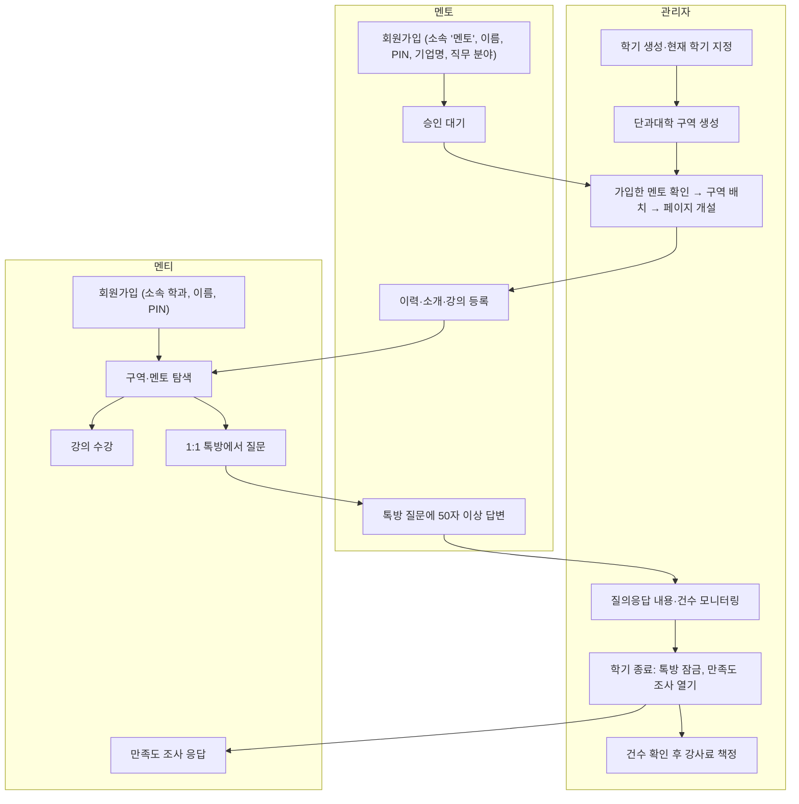
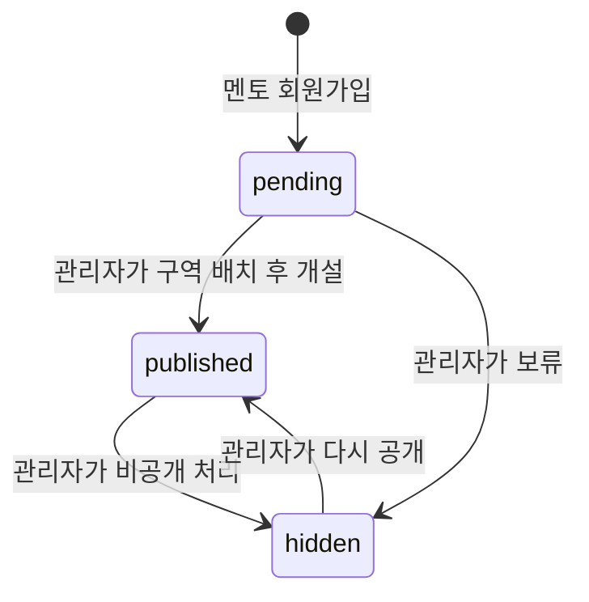
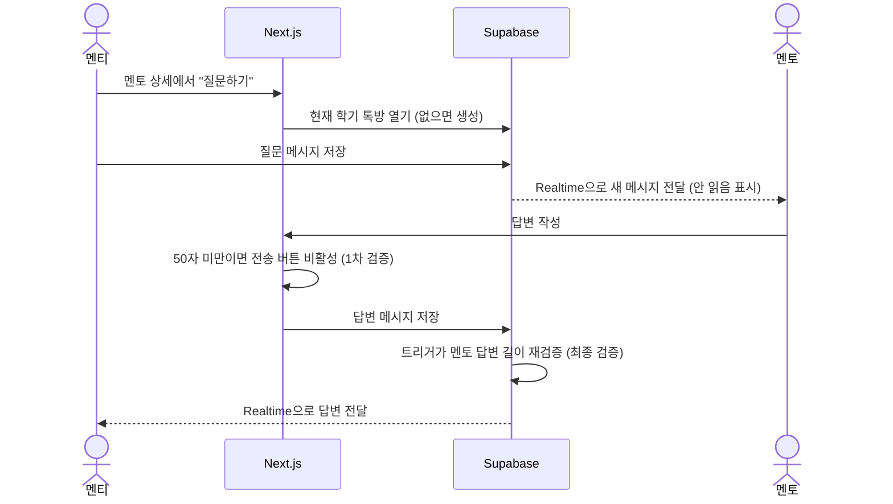
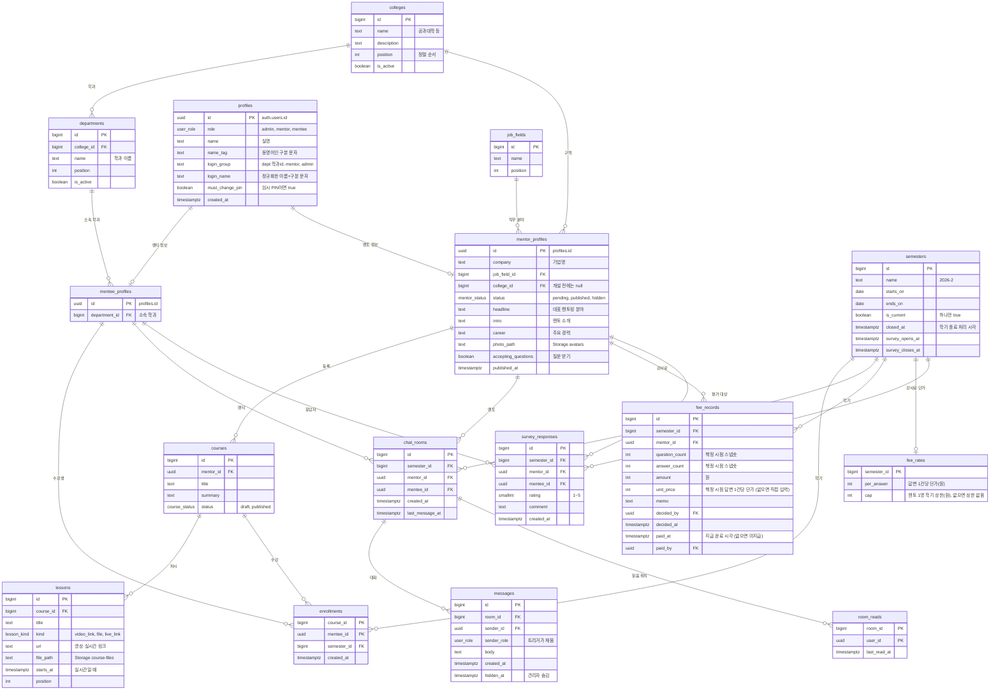

# 서비스 구조 설계

[README](../README.md)의 기획과 [잇다 구조 분석](itdaa-structure.md)을 합쳐 만든 hoseo.mentor-bridge의 구조 설계입니다. 구현할 때 이 문서를 기준으로 삼고, 바뀌는 내용은 이 문서에 먼저 반영합니다.

- 작성일: 2026-10-29
- 스택: Next.js 16 (App Router) + Supabase (Auth, Postgres, Realtime, Storage) + refine(관리자 화면)
- README "추가 확인 사항"과 설계 중 새로 생긴 결정 사항은 2026-10-29에 [11장](#11-결정-사항)의 값으로 확정했습니다. 나중에 바뀌어도 고칠 곳이 적도록 규칙을 설정 테이블과 함수에 모아 두었습니다.

## 목차

1. [설계 원칙](#1-설계-원칙)
2. [역할과 권한](#2-역할과-권한)
3. [핵심 흐름](#3-핵심-흐름)
4. [화면 구조](#4-화면-구조)
5. [데이터 모델](#5-데이터-모델)
6. [핵심 규칙 구현](#6-핵심-규칙-구현)
7. [보안 (RLS)](#7-보안-rls)
8. [실시간과 알림](#8-실시간과-알림)
9. [프런트엔드 구조](#9-프런트엔드-구조)
10. [운영 제약](#10-운영-제약)
11. [결정 사항](#11-결정-사항)
12. [구현 단계](#12-구현-단계)

## 1. 설계 원칙

| 원칙 | 내용 |
| --- | --- |
| 단과대학 중심 | 잇다는 직무 카테고리가 최상위지만, 우리는 **단과대학 구역**이 최상위이고 직무 분야는 보조 필터입니다. |
| 관리자가 문을 연다 | 멘토는 가입만으로 공개되지 않습니다. 관리자가 구역에 배치하고 멘토 페이지를 개설해야 공개됩니다. |
| 학기 단위 | 톡방, 수강, 강사료, 만족도 조사는 모두 학기에 묶입니다. 학기가 끝나면 톡방은 읽기 전용이 됩니다. |
| 보안은 DB에서 | 권한은 화면이 아니라 Supabase RLS 정책으로 지킵니다. 화면의 권한 검사는 사용 편의를 위한 것입니다. |
| 규칙은 한 곳에 | 50자 기준처럼 바뀔 수 있는 규칙은 설정 테이블과 함수 하나에 모아 둡니다. |
| 작게 시작 | 학교 안 소규모 운영이므로 무료 플랜 안에서 동작하게 만들고, 잇다의 광고·VOD·유료화 기능은 넣지 않습니다. |

## 2. 역할과 권한

### 2.1 역할

| 역할 | 누구 | 계정 생성 | 로그인 |
| --- | --- | --- | --- |
| 멘티 (`mentee`) | 재학생 | 직접 가입 (소속 학과, 이름, PIN) | 학과 + 이름 + PIN |
| 멘토 (`mentor`) | 기업 현직자 | 직접 가입 (소속 "멘토", 이름, PIN, 기업명, 직무 분야) → 관리자가 페이지 개설 | "멘토" + 이름 + PIN |
| 관리자 (`admin`) | 운영 담당 교직원·학생 | 다른 관리자가 만듦. 첫 관리자는 설치 스크립트로 생성 (가입 화면으로는 될 수 없음) | "관리자" + 이름 + PIN |

### 2.2 기능별 권한

| 기능 | 비로그인 | 멘티 | 멘토 | 관리자 |
| --- | :---: | :---: | :---: | :---: |
| 메인·서비스 소개·이용 안내 | ✅ | ✅ | ✅ | ✅ |
| 단과대학 구역·멘토 목록(카드) 보기 | ✅ | ✅ | ✅ | ✅ |
| 멘토 상세 보기 | | ✅ | ✅ | ✅ |
| 강의 목록 보기 | ✅ | ✅ | ✅ | ✅ |
| 강의 상세(소개·차시) 보기 | | ✅ | ✅ | ✅ |
| 강의 수강 신청, 자료 보기 | | ✅ | | ✅ (보기) |
| 멘토에게 1:1 질문 (톡방 열기) | | ✅ | | |
| 톡방에서 답변 (50자 이상) | | | ✅ 본인 톡방 | |
| 본인 페이지 이력·소개 편집, 강의 등록 | | | ✅ | ✅ |
| 단과대학 구역 관리 | | | | ✅ |
| 멘토 승인·구역 배치·페이지 개설 | | | | ✅ |
| 모든 톡방 내용과 건수 보기 | | | | ✅ |
| 강사료 책정 | | | | ✅ |
| 학기 관리, 만족도 조사 결과 보기 | | | | ✅ |
| 만족도 조사 응답 | | ✅ (학기 말) | | |
| 내 PIN 변경 | | ✅ | ✅ | ✅ |
| 다른 사용자 PIN 초기화, 이름·소속 변경, 관리자 계정 생성 | | | | ✅ |

비로그인 방문자는 메인, 서비스 소개, 이용 안내, 단과대학 구역, 멘토 찾기(카드), 강의 목록까지 볼 수 있습니다. 멘토 카드에는 사진·이름·기업명·직무 분야·대표 멘토링 분야·구역만 나오고, 상세·질문·수강·톡방은 로그인한 뒤에 씁니다. 그 밖의 주소로 오면 로그인 화면(`/auth/login?next=원래 주소`)으로 보내고, 로그인하면 원래 주소로 돌아갑니다. 공개 데이터는 공개 함수(`public_mentors()` 등)로만 나가며 `app_settings.public_browsing`을 끄면 모두 숨깁니다 (11장 8번, 2026-11-06 변경).

## 3. 핵심 흐름

### 3.1 한 학기 운영 흐름



### 3.2 멘토 페이지 상태



- `published`가 되려면 단과대학 구역(`college_id`)이 반드시 있어야 합니다.
- 멘토 본인은 상태와 구역을 바꿀 수 없습니다. 소개, 경력, 사진(11장 18번), "질문 받기" 여부만 바꿉니다. 기업명과 직무 분야도 관리자가 바꿉니다(`protect_mentor_columns()` 트리거).

### 3.3 1:1 질문과 답변



## 4. 화면 구조

### 4.1 사이트맵과 접근 권한

| 경로 | 화면 | 접근 | 잇다에서 가져온 요소 |
| --- | --- | --- | --- |
| `/` | 메인: 빨간 대문(호서대 로고·멘토 찾기·로그인), 단과대학 구역 카드, 새로 개설된 멘토, 모집 중인 강의, 이용 순서. 로그인했으면 환영 안내 | 누구나 | 메인 섹션 구성 |
| `/about` | 서비스 소개, 운영 주체 | 누구나 | |
| `/guide` | 이용 안내, 자주 묻는 질문, 문의 | 누구나 | |
| `/courses` | 모집 중인 강의 목록 (상세는 로그인) | 누구나 | |
| `/colleges/[collegeId]` | 단과대학 구역: 구역 소개, 소속 멘토 카드 | 누구나 (카드를 누르면 로그인) | 멘토 카드 |
| `/mentors` | 멘토 찾기: 구역·직무 분야 필터, 검색, 페이지 | 누구나 (카드를 누르면 로그인) | 필터 바, URL 배열 파라미터 |
| `/mentors/[mentorId]` | 멘토 상세: 프로필, 활동 지표, 소개, 경력, 강의, 질문하기 | 로그인 | 프로필 헤더, 지표, 소개·경력 |
| `/courses/[courseId]` | 강의 상세: 소개, 차시 목록, 수강 신청 | 로그인 | 클래스 상세 구성 |
| `/chats` | 내 톡방 목록 (안 읽은 수) | 멘티·멘토 | |
| `/chats/[roomId]` | 1:1 톡방 | 해당 멘티·멘토, 관리자(읽기) | |
| `/mypage` | 내 정보, 수강 중인 강의, 만족도 조사 | 멘티 | |
| `/mentor` | 멘토 대시보드: 받은 질문, 내 페이지 편집, 강의 관리 | 멘토 | |
| `/admin` | 관리자 (refine) | 관리자 | |
| `/admin/semesters` | 학기 생성·현재 학기·종료 | 관리자 | |
| `/admin/colleges` | 단과대학 구역과 소속 학과 관리 | 관리자 | |
| `/admin/mentors` | 승인 대기 멘토, 구역 배치, 개설·비공개 | 관리자 | |
| `/admin/users` | 사용자 목록, PIN 초기화, 이름·소속 변경, 관리자 계정 생성, 탈퇴 처리 | 관리자 | |
| `/admin/backup` | 전체 백업(JSON·CSV), 보관 기간이 지난 회원 | 관리자 | |
| `/admin/chats` | 전체 톡방 목록·내용, 멘토별 질문·답변 건수 | 관리자 | |
| `/admin/fees` | 학기별 강사료 책정 | 관리자 | |
| `/admin/surveys` | 만족도 조사 결과 | 관리자 | |
| `/auth/login`, `/auth/sign-up` | 로그인(소속·이름·PIN), 역할별 회원가입(개인정보 동의 포함) | 비로그인 | |
| `/privacy` | 개인정보 처리방침 | 누구나 | |
| `/account/pin` | PIN 변경. 임시 PIN으로 로그인하면 이 화면으로 이동 | 로그인 | |

필터는 잇다처럼 URL에 담아 공유와 뒤로 가기를 지원합니다. 예: `/mentors?college=3&field=7&q=백엔드&page=2`

### 4.2 주요 화면 구성

**멘토 카드**: 사진 · 이름 · 기업명 · 직무 분야 · 대표 멘토링 분야 한 줄 · 단과대학 구역 · 상태(`질문 가능` / `질문 마감`)

**멘토 상세**

1. 프로필 헤더: 사진, 단과대학 구역, 이름, 기업명, 직무 분야
2. 활동 지표: 답변 수, 답변율(질문 받은 톡방 중 답변한 비율), 수강생 수
3. 버튼: **질문하기** (멘티만, 멘토가 질문 받기를 켠 경우)
4. 대표 멘토링 분야, 멘토 소개, 주요 경력
5. 등록한 강의 목록

**1:1 톡방**: 상대 정보 헤더(프로필 사진 포함) · 메시지 목록(질문·답변 말풍선, 카카오톡처럼 상대 메시지 왼쪽에 프로필 사진과 이름. 같은 사람이 3분 안에 이어 보낸 메시지는 첫 메시지에만 붙임. 멘티는 사진이 없어 기본 이미지) · 입력창. 멘토 입력창은 글자 수를 실시간으로 보여 주고 50자 전에는 전송을 막습니다. 학기가 끝난 톡방은 입력창 대신 "종료된 톡방" 안내를 보여 줍니다.

**로그인**: 소속 선택(단과대학별 학과 목록, "멘토", "관리자") · 이름 · PIN 6자리

**회원가입**: 소속에서 학과를 고르면 멘티로, "멘토"를 고르면 멘토로 가입합니다. 가입 화면의 소속 목록에는 "관리자"가 없습니다.

| 역할 | 공통 | 역할별 |
| --- | --- | --- |
| 멘티 | 소속(학과), 이름, PIN, PIN 확인 | 없음 |
| 멘토 | 소속("멘토"), 이름, PIN, PIN 확인 | 기업명, 직무 분야 (선택 목록) |

같은 소속에 같은 이름이 이미 있으면 구분 문자 입력칸을 보여 주고 이름 뒤에 붙이라고 안내합니다 ([6.1](#61-로그인과-가입-소속이름pin)).

## 5. 데이터 모델

### 5.1 ERD



`app_settings`(설정값 한 줄짜리 테이블)는 관계가 없어 그림에서 뺐습니다.

### 5.2 테이블 설명과 제약

| 테이블 | 역할 | 주요 제약 |
| --- | --- | --- |
| `profiles` | 모든 사용자의 공통 정보와 로그인 키. `auth.users`와 1:1 | 가입 트리거만 생성. `(login_group, login_name)` 중복 불가. `role`·이름·소속은 관리자만 변경 |
| `mentee_profiles` | 멘티의 소속 학과 | 멘티일 때만 존재. `department_id`는 `profiles.login_group`과 일치 |
| `mentor_profiles` | 멘토 페이지 내용과 공개 상태 | `status = 'published'`이면 `college_id` 필수. `status`, `college_id`, `published_at`은 관리자만 변경 |
| `colleges` | 단과대학 구역 | `name` 중복 불가 |
| `departments` | 단과대학 아래 학과. 가입·로그인의 소속 목록 | (단과대학, 이름) 중복 불가. 로그인 키가 학과 id를 쓰므로 지우지 않고 `is_active = false`로 숨김 |
| `job_fields` | 직무 분야 목록 (관리자 관리) | `name` 중복 불가 |
| `semesters` | 학기 | `is_current = true`는 하나만 (부분 유니크 인덱스) |
| `courses` | 멘토 강의 | 작성자는 멘토 본인 |
| `lessons` | 강의 차시. 영상 링크, 파일, 실시간 링크 중 하나 | `kind`에 맞는 열만 값 존재 (CHECK) |
| `enrollments` | 수강 신청 | (강의, 멘티) 중복 불가. `semester_id`는 신청 시점의 현재 학기 (트리거) |
| `chat_rooms` | 멘티-멘토 1:1 톡방 | (학기, 멘토, 멘티) 중복 불가 |
| `messages` | 톡방 메시지 | 멘토 메시지는 답변 길이 규칙 통과 필수. 수정·삭제 불가 (관리자 숨김만) |
| `room_reads` | 사용자별 마지막 읽은 시각 | 안 읽은 수 계산용 |
| `fee_records` | 학기별 멘토 강사료 | (학기, 멘토) 중복 불가. 지급 완료(`paid_at`) 뒤에는 금액·건수·메모를 못 고침 (지급 취소 후 수정) |
| `fee_rates` | 학기별 강사료 단가와 상한 | 학기당 한 줄. 관리자만 읽고 씀 (멘토에게 보이지 않음, 11장 9번) |
| `survey_responses` | 학기 말 멘토 만족도 | (학기, 멘토, 멘티) 중복 불가. 그 학기에 해당 멘토에게 질문하고 답변을 받은 멘티만 (11장 28번) |
| `app_settings` | 바뀔 수 있는 운영 규칙 | 한 줄만 존재 |
| `admin_invites` | 관리자 계정 생성 허가 (6.1) | secret 키로만 읽고 씀. 가입 트리거가 쓰고 지움 |

`app_settings` 열:

| 열 | 기본값 | 의미 |
| --- | --- | --- |
| `answer_min_length` | `50` | 멘토 답변 최소 글자 수 |
| `answer_count_spaces` | `false` | 글자 수에 공백을 포함할지. 공백 제외로 확정 |
| `public_browsing` | `true` (2026-11-06) | 비로그인 방문자에게 멘토 카드·강의 목록을 보여 줄지. 끄면 공개 함수가 빈 결과를 돌려줌 |

### 5.3 DB 함수

| 함수 | 용도 |
| --- | --- |
| `normalize_login_name(raw)` | 이름 + 구분 문자를 `login_name`으로 정규화. 앱의 `normalizeLoginName()`과 같은 결과를 냄 (6.1) |
| `login_email(login_group, login_name)` | 가상 이메일 계산. 앱의 `lib/auth/login-key.ts`와 같은 결과를 냄 (6.1) |
| `is_admin()` | 현재 사용자가 관리자인지. RLS 정책에서 사용 (비로그인 실행 권한 없음) |
| `is_backend()` | secret 키(`service_role`)나 운영 SQL로 들어온 요청인지. 보호 열 트리거에서 사용 |
| `is_room_member(room_id)` | 현재 사용자가 톡방 참여자인지 |
| `answer_length(body)` | `app_settings` 기준 글자 수 계산 (공백 포함 여부 반영) |
| `handle_new_user()` | `auth.users` 생성 시 `profiles`와 역할별 테이블 생성 (트리거) |
| `guard_login_email()` | `auth.users`의 이메일이 바뀔 때 `profiles`의 로그인 키와 맞는지 확인 (트리거) |
| `protect_profile_columns()`, `protect_mentor_columns()` | 보호 열 변경 차단 (트리거, 6.1·6.2) |
| `open_chat_room(mentor_id)` | 멘티가 현재 학기 톡방을 열거나 기존 방 반환 (RPC) |
| `set_current_semester(semester_id)` | 현재 학기 지정 (관리자 전용 RPC). 하나만 현재 학기가 되도록 기존 것을 내림 |
| `mark_room_read(room_id)` | 내 읽은 위치를 지금으로 (RPC) |
| `my_unread_counts()` | 내 톡방별 안 읽은 메시지 수 (RPC) |
| `mentor_activity(mentor_id)` | 멘토 상세의 답변 수(질문마다 1건, 11장 26번)·질문 받은 톡방 수·답변한 톡방 수 (RPC, 집계만 돌려줌) |
| `course_outline(course_id)` | 강의 소개 화면의 차시 목록 (제목·종류·실시간 시각만, 링크·파일 제외) |
| `course_enrollment_count(course_id)`, `mentor_student_count(mentor_id)` | 수강생 수 (숫자만) |
| `can_view_course(course_id)`, `can_access_course_materials(course_id)` | 강의를 볼 수 있는지, 자료를 볼 수 있는지 (RLS·Storage 정책에서 사용) |
| `admin_semester_stats(semester_id)` | 멘토별 톡방 수, 질문 수, 답변 수, 마지막 답변 시각 (관리자 전용 RPC). 관리자가 숨긴 메시지는 세지 않음 |
| `close_semester(semester_id, survey_closes_at)` | 학기 종료: `closed_at` 기록, 만족도 조사 기간(지금 ~ 관리자가 정한 마감, 화면 기본값 2주 뒤) 설정 (관리자 전용 RPC) |
| `my_pending_surveys()` | 내가 응답할 만족도 조사 (종료된 학기의 조사 기간 안, 그 학기에 질문하고 답변을 받은 멘토마다) |

Supabase Edge Function `admin-users`는 PIN 초기화, 이름·소속 변경, 관리자 계정 생성을 맡습니다. Supabase 관리자 API가 필요한 작업이라 DB 함수가 아니라 Edge Function으로 두고, 호출한 사람이 관리자인지 먼저 확인합니다.

## 6. 핵심 규칙 구현

### 6.1 로그인과 가입 (소속·이름·PIN)

Supabase Auth는 이메일(또는 전화번호)과 비밀번호로 계정을 만듭니다. 그래서 사용자가 입력한 소속과 이름으로 **가상 이메일**을 계산하고, PIN을 비밀번호로 씁니다. 사용자는 이메일을 보거나 입력하지 않습니다.

**로그인 키**

| 값 | 만드는 방법 | 예 |
| --- | --- | --- |
| `login_group` | 멘티 `dept:<학과 id>`, 멘토 `mentor`, 관리자 `admin` | `dept:12` |
| `login_name` | 이름 + 구분 문자를 유니코드 정규화(NFC)하고, 공백을 모두 빼고, 영문은 소문자로 | `홍길동a` |
| 가상 이메일 | `u-` + SHA-256(`login_group` + `\|` + `login_name`)의 앞 32자 + `@login.hoseo-mentor.invalid` | `u-3f9c…@login.hoseo-mentor.invalid` |

- 같은 계산을 앱(`lib/auth/login-key.ts`)과 DB(`login_email()`)에 둡니다. 앱은 로그인·가입에, DB는 가입 검증에 씁니다.
- 학과 이름이 바뀌어도 학과 id는 그대로라 로그인에 영향이 없습니다.
- 가상 주소로 메일이 나가지 않도록 Supabase의 이메일 인증(Confirm email)을 끕니다.
- 도메인은 예약 최상위 도메인 `.invalid`(RFC 2606)를 씁니다. 실제로 있을 수 없는 주소라 혹시 메일이 나가도 남의 서버로 가지 않고, 배포 도메인(11장 11번)과도 상관이 없습니다. 바꾸면 모든 계정의 로그인 키가 바뀌므로 고정합니다.
- 2026-10-30에 실제 프로젝트에서 확인했습니다: 이 도메인으로 `signUp`이 받아들여지고 바로 세션이 나옴, 틀린 PIN은 `invalid_credentials`, PIN 변경은 현재 PIN이 없거나 틀리면 거부(`current_password_required`, `current_password_invalid`).

**가입**

1. 화면에서 소속, 이름, (필요하면) 구분 문자, PIN 6자리, PIN 확인을 받습니다. 멘토는 기업명과 직무 분야도 받습니다.
2. 서버 액션이 PIN 형식(숫자 6자리)을 검사하고, 가상 이메일을 계산해 `supabase.auth.signUp()`을 호출합니다. 소속·이름·역할별 정보는 `options.data`로 넘깁니다.
3. `handle_new_user()` 트리거가 다시 검사하고 `profiles`와 역할별 테이블을 만듭니다.
   - 이메일이 `login_email(login_group, login_name)`과 같은지 확인합니다. API를 직접 불러 임의의 이메일로 가입하는 것을 막습니다.
   - 소속이 `admin`이면 거부합니다. 단, secret 키로만 쓸 수 있는 `admin_invites`에 그 이메일의 허가(10분 유효)가 있으면 허가를 지우고 관리자로 만듭니다(첫 관리자 스크립트, `admin-users`). Supabase Auth는 사용자를 만든 뒤에 `app_metadata`를 저장해서 트리거가 볼 수 없기 때문에 허가 표를 씁니다. `mentor`이면 멘토로 만들고, `dept:<id>`이면 쓰고 있는 학과인지 확인한 뒤 멘티로 만듭니다.
   - 멘토는 `job_field_id`를 확인하고 `status = 'pending'`으로 만듭니다.
4. 이메일 인증이 없으므로 가입 직후 바로 로그인됩니다.

**동명이인**: `(login_group, login_name)`은 중복될 수 없습니다. 같은 소속에 같은 이름이 있으면 가입 화면이 구분 문자(영문·숫자 1~3자, 예: `A`)를 붙이라고 안내합니다. 화면에는 `홍길동A`처럼 이름과 구분 문자를 함께 보여 주고, 로그인할 때도 이름칸에 `홍길동A`라고 씁니다.

**이름에 쓸 수 있는 글자**: 한글 음절·영문과 그 사이의 공백 한 칸, 30자까지입니다 (`profiles.name` CHECK). 보이지 않는 글자(폭 없는 공백 등)를 섞어 남과 같아 보이는 이름으로 가입하는 것을 막기 위해서입니다.

**로그인 키 가로채기 방지**: 사용자가 `updateUser({ email })`로 이메일을 남의 가상 이메일로 바꾸면, 그 사람이 나중에 가입할 로그인 키를 미리 차지할 수 있습니다. `guard_login_email()` 트리거가 이메일은 늘 `login_email(profiles.login_group, profiles.login_name)`과 같아야 한다고 막습니다. 그래서 `admin-users`가 이름·소속을 바꿀 때는 `profiles`를 먼저 고친 뒤 이메일을 바꿉니다.

**로그인**: 소속·이름·PIN을 받은 서버 액션이 가상 이메일을 계산해 `signInWithPassword()`를 호출합니다. 실패하면 "소속, 이름 또는 PIN이 맞지 않습니다"라고만 안내해 어느 값이 틀렸는지 알려 주지 않습니다.

**PIN 변경 (누구나, 언제든)**

- `/account/pin`에서 현재 PIN, 새 PIN, 새 PIN 확인을 받습니다.
- Supabase의 "비밀번호를 바꿀 때 현재 비밀번호 요구(Require current password)"를 켜고 `updateUser({ current_password, password })`로 바꿉니다. 메일로 확인 코드를 보내는 "재인증(Secure password change)"은 메일이 없으므로 끕니다.
- 새 PIN이 숫자 6자리인지는 서버 액션에서 검사합니다. Supabase는 비밀번호 원문을 DB에 넘기지 않으므로 DB에서는 검사할 수 없습니다.
- PIN이 실제로 바뀌면 DB 트리거(`auth.users` 비밀번호 변경)가 `must_change_pin`을 `false`로 돌립니다. 본인이 표시만 직접 끌 수는 없습니다 (보안 검수 2차).
- 바꾸고 나면 지금 쓰는 기기 말고 다른 기기의 로그인을 끊습니다(`revoke_other_sessions()`). PIN이 새어 나갔을 때 남의 기기에 로그인이 남지 않게 합니다.

**PIN 분실**: 메일이 없어 스스로 찾을 수 없습니다. 관리자가 `/admin/users`에서 임시 PIN을 정해 주면 `must_change_pin = true`가 되고, 그 사용자는 다음 로그인 때 `/account/pin`으로 이동합니다. 초기화하면 그 사람의 모든 기기 로그인이 끊깁니다(`revoke_user_sessions()`, `admin-users`만 호출).

**이름·소속 변경**: 로그인 키가 바뀌므로 관리자만 합니다. 가상 이메일도 함께 바꿉니다.

**관리자 계정**: 가입 화면으로는 만들 수 없습니다. 관리자가 `/admin/users`에서 만들고(임시 PIN, 처음 로그인할 때 변경), 첫 관리자는 운영자 PC에서 한 번 실행하는 설치 스크립트로 만듭니다: `node --env-file=.env.local scripts/create-admin.mjs` (secret 키는 실행할 때 입력받고 저장하지 않음).

**임시 PIN**: PIN 초기화와 관리자 생성의 임시 PIN은 서버에서 무작위 6자리로 정해 관리자 화면에 한 번만 보여 줍니다.

PIN 초기화, 이름·소속 변경, 관리자 생성에는 Supabase 관리자 API가 필요합니다. 이 작업은 Edge Function `admin-users`가 secret 키로 처리하고, 호출한 사람이 관리자인지 먼저 확인합니다. Next.js 앱 코드에는 secret 키를 넣지 않습니다.

**무작위 대입 대책**

- PIN 6자리는 경우의 수가 100만 개입니다. Supabase는 로그인 요청을 IP마다 시간당 1,800회(순간 30회)로 제한합니다.
- 실패 횟수에 따라 계정을 잠그는 기능(Password Verification Hook)은 Supabase 유료(Teams 이상) 플랜에만 있어서 쓸 수 없습니다.
- 그래서 Supabase에 내장된 **CAPTCHA(Cloudflare Turnstile, 무료)**를 가입·로그인에 켭니다. 우리 화면을 거치지 않고 API를 직접 부르는 공격도 CAPTCHA 토큰이 있어야 하므로 함께 막힙니다. 실제 사용자를 받기 전에 반드시 켭니다.
  - 화면: 로그인·가입 화면에 Turnstile 위젯(관리형 모드)을 넣습니다. 위젯이 준 토큰을 서버 액션이 `signInWithPassword`·`signUp`의 `options.captchaToken`으로 넘깁니다. 토큰은 한 번만 쓸 수 있어 실패 응답이 오면 위젯을 새로 고치고, 토큰을 받기 전에는 제출 버튼을 끕니다.
  - site key는 공개 값이라 `wrangler.jsonc`의 `TURNSTILE_SITE_KEY`에 둡니다(서버가 실행할 때 읽어 화면에 넘김). 값이 없으면 위젯을 그리지 않습니다. secret key는 Supabase 대시보드(Authentication → Bot and Abuse Protection)에만 넣고 저장소에는 두지 않습니다.
  - 켜는 순서: ① Cloudflare에서 위젯을 만들고(호스트 이름: 배포 주소, `localhost`) ② site key를 넣은 코드를 배포한 뒤 ③ Supabase에서 CAPTCHA를 켭니다. 순서를 바꾸면 그 사이에는 아무도 로그인할 수 없습니다. Supabase는 CAPTCHA가 꺼져 있으면 토큰을 무시하므로 ②까지는 지금처럼 동작합니다.
  - CAPTCHA를 켜면 공개 API로 가입·로그인하는 시험 스크립트도 토큰이 필요합니다. 자동 시험에는 Cloudflare의 시험용 키를 쓰는 로컬 환경이나 관리자 API(Edge Function)로 만든 계정을 씁니다.
- 이름과 학과는 남이 알 수 있는 정보라 PIN이 유일한 비밀입니다. 생일·학번처럼 추측하기 쉬운 숫자는 피하라고 화면에서 안내합니다.

### 6.2 멘토 페이지 개설

- 관리자 화면 `/admin/mentors`에 `pending` 멘토가 모입니다.
- 관리자가 단과대학 구역을 고르고 개설하면 `college_id`, `status = 'published'`, `published_at`이 한 번에 저장됩니다.
- 멘토 본인이 보호 열(`status`, `college_id`, `published_at`)을 바꾸려 하면 트리거가 막습니다. 관리자도 같은 `authenticated` 역할로 접속하므로 열 권한이 아니라 트리거에서 `is_admin()`으로 구분합니다.

### 6.3 50자 답변 검증

- **화면**: 멘토 입력창에 현재 글자 수와 기준을 보여 주고, 기준 미만이면 전송 버튼을 끕니다.
- **DB**: `messages` INSERT 트리거가 `sender_role`을 채우고, 멘토 메시지면 `answer_length(body) >= answer_min_length`를 검사합니다. 실패하면 에러를 돌려줍니다.
- 확정 기준은 **공백을 뺀 50자 이상**입니다. 기준이 바뀌면 `app_settings`만 고치면 됩니다. 화면은 같은 설정을 읽어 표시합니다.
- 한국어 한 글자는 Postgres `char_length`에서 1자로 셉니다.

### 6.4 톡방 규칙

- 톡방은 **학기마다** 멘티-멘토 쌍당 하나입니다. 다음 학기에 같은 멘토에게 질문하면 새 톡방이 열립니다.
- 열 수 있는 조건: 멘티 본인, 현재 학기 존재, 멘토가 `published`이고 `accepting_questions = true`
- 메시지를 쓸 수 있는 조건: 톡방 참여자이고 학기가 종료되지 않음
- 메시지는 수정·삭제할 수 없습니다. 강사료 산정 근거가 되기 때문입니다. 부적절한 메시지는 관리자가 숨깁니다(`hidden_at`).
- 메시지는 5000자까지입니다. 보낸 사람과 역할(`sender_role`)은 트리거가 로그인 정보로 채우므로 API로 바꿔 보낼 수 없습니다.
- 3단계에서는 관리자 화면 `/admin/semesters`에 학기 만들기와 현재 학기 지정만 두었습니다. 학기 종료는 5단계입니다.
- 수강 신청을 하지 않아도 질문할 수 있습니다. README에서 강의 수강과 질문은 별도 단계이기 때문입니다.

**강의 (4단계)**: 멘토가 `/mentor`에서 강의를 만들고(처음은 비공개) 차시를 영상 링크·자료 파일·실시간 링크로 추가합니다. 수강 신청은 현재 학기가 있을 때만 되고, 신청한 멘티는 `/mypage`에서 수강 중인 강의를 봅니다. 수강을 취소하면 자료를 더 볼 수 없습니다.

### 6.5 학기 운영

1. 관리자가 학기를 만들고 현재 학기로 지정합니다.
2. 학기 중에는 톡방·수강이 현재 학기에 기록됩니다.
3. 학기 종료(`close_semester`)
   - `closed_at`을 기록합니다. 이후 그 학기 톡방은 읽기 전용입니다.
   - 만족도 조사 기간(`survey_opens_at` ~ `survey_closes_at`)을 엽니다.
4. 만족도 조사: 그 학기에 그 멘토에게 질문하고 답변을 1번 이상 받은 멘티만, 해당 멘토마다 한 번 응답합니다 (README "종료 시 멘티 한정"의 해석, 11장 4번·28번).
5. 다음 학기를 만들고 현재 학기로 바꿉니다.

### 6.6 질의응답 현황과 강사료

- `/admin/chats`: 학기·구역·멘토로 걸러 전체 톡방을 보고, 톡방을 열어 내용을 확인합니다.
- `admin_semester_stats()`가 멘토별 톡방 수, 질문 수, 답변 수, 마지막 답변 시각을 돌려줍니다. 질문·답변은 "차례"로 셉니다(11장 26번): 멘티가 연달아 보낸 메시지 묶음이 질문 1건, 그 뒤 멘토가 연달아 보낸 메시지 묶음이 답변 1건입니다. 짧게 나눠 여러 번 보내도 건수가 늘지 않습니다.
- `/admin/fees`: 통계 옆에서 관리자가 금액을 입력하면 `fee_records`에 그 시점의 건수 스냅숏과 함께 저장합니다.
- 학기마다 "답변 1건당 단가"와 "멘토 1명 상한"(선택)을 정해 둡니다(`fee_rates`, 11장 29·30번). 화면이 멘토마다 `계산 금액 = min(답변 수 × 단가, 상한)`을 보여 주고 금액 칸에 미리 채웁니다. 관리자는 확인하고 필요하면 고쳐서 책정합니다. 책정할 때의 단가도 `fee_records.unit_price`에 남깁니다.
- 지급하면 "지급 완료"를 눌러 지급 시각과 처리한 관리자를 남깁니다(11장 31번). 지급 완료 뒤에는 금액을 고칠 수 없고(DB 트리거), 실수였다면 "지급 취소" 뒤 고칩니다. 화면 위에 책정·지급 완료·미지급 합계를 보여 줍니다.
- 책정 뒤 건수가 바뀌면(관리자가 메시지를 숨기거나 되돌림) 강사료 화면에 "책정 뒤 건수가 바뀌었습니다"를 보여 줍니다.
- 멘티는 학기가 종료되면 홈 안내와 `/mypage`에서 만족도 조사에 응답합니다. 결과(`/admin/surveys`)에는 응답자 이름을 보여 주지 않습니다.

### 6.7 개인정보 처리와 백업

- **운영자·담당자**: 호서대학교 취업팀(2026-11-04 창업팀에서 바꿈, 처리방침 시행일 2026-11-04), 개인정보 보호책임자 양정환(010-3830-5972). 값은 `lib/privacy/policy.ts` 한곳에 두고 처리방침·가입 화면·화면 아래 링크가 함께 씁니다.
- **처리방침**: `/privacy`. 로그인하지 않아도 볼 수 있고(`lib/supabase/proxy.ts`의 공개 경로), 모든 화면 아래에 링크가 있습니다. 내용을 바꾸면 `PRIVACY_POLICY_VERSION`(시행일)을 올립니다.
- **가입 동의**: 회원가입 화면에서 수집 항목·목적·보유 기간·거부할 권리를 보여 주고 필수 체크를 받습니다. 서버 액션이 처리방침 판을 가입 정보에 넣고, 가입 트리거가 판이 없으면 거부한 뒤 `privacy_consents`에 기록합니다(API를 직접 불러도 동의 없이는 가입 불가). 관리자 계정은 운영진이라 동의를 받지 않습니다.
- **보관 기간**: 마지막 이용(로그인 또는 세션 갱신) 후 1년. 기간이 지난 멘티·멘토는 `/admin/backup`의 "보관 기간이 지난 회원"에 나오고(`inactive_members()`), 관리자가 백업을 받은 뒤 탈퇴 처리합니다. 자동 삭제는 하지 않습니다.
- **탈퇴**: 화면에 본인 탈퇴 기능은 없습니다. 본인이 담당자에게 요청하면 관리자가 `/admin/users`의 "탈퇴 처리"로 지웁니다(이름을 입력해 확인). `admin-users`의 `delete_user`가 멘토의 강의 파일(Storage)을 먼저 지우고 계정을 지우면, DB의 나머지 데이터는 `on delete cascade`로 함께 지워집니다. 멘티를 지우면 그 멘티의 톡방(멘토 답변 포함)도 지워지므로 지난 학기 건수가 줄 수 있지만, 강사료 기록(`fee_records`)은 책정 당시 건수를 따로 갖고 있습니다. 자기 계정과 마지막 관리자는 지울 수 없습니다.
- **백업**: `/admin/backup`의 "전체 백업 받기"가 DB 함수 `admin_backup()`(관리자만)으로 서비스 데이터 전체를 JSON 파일 하나로 내려받게 합니다. 표마다 엑셀용 CSV도 받을 수 있습니다. PIN 해시와 강의 파일은 들어가지 않습니다. 언제 받고 어디에 두고 어떻게 되살리는지는 [backup.md](backup.md)에 있습니다.

### 6.8 사용자 PC 기억 (로그인 유지)

- Supabase Auth 세션은 기본적으로 로그아웃할 때까지 유지되고, `@supabase/ssr`가 쿠키에 저장합니다. 지금 뼈대에서 이미 "재방문 시 사용자 기억"이 됩니다.
- 세션 최대 시간·미사용 만료 설정은 Supabase 유료(Pro) 플랜 기능이라 무료 플랜에서는 쓸 수 없습니다.
- 확정: 로그아웃할 때까지 로그인을 유지합니다. 1차에서는 "로그인 상태 유지" 체크박스를 두지 않습니다.
- 나중에 공용 PC 때문에 체크박스가 필요해지면, 체크를 끈 경우 브라우저를 닫으면 사라지는 쿠키로 저장하는 방식을 따로 구현합니다.

### 6.9 새 메시지 웹 푸시 알림

- **누가 받나**: 멘티가 질문하면 멘토에게, 멘토가 답하면 멘티에게. 멘티는 마이페이지(`/mypage`), 멘토는 내 멘토 페이지(`/mentor`)에서 "알림 받기"를 켠 브라우저에만 보냅니다(선택). 2026-11-04 톡방 목록에 있던 알림 칸은 마이페이지로 옮겼고, 로그인 뒤 홈에서 알림이 꺼져 있으면 "마이페이지(멘토는 내 멘토 페이지)에서 켤 수 있다"는 팝업을 브라우저마다 한 번만 띄웁니다. 알림 칸 아래에는 "알림이 오지 않나요?" 확인 목록(사이트 허용, 윈도우·맥·안드로이드·아이폰별 알림·방해 금지·백그라운드 실행 설정)을 접어 두고, 지금 쓰는 기기 항목을 맨 위에 보여 줍니다. 같은 곳에 "앱으로 설치" 칸이 있습니다: 안드로이드·PC 크롬·엣지는 버튼으로 설치 창을 띄우고(`beforeinstallprompt`), 아이폰은 공유 → 홈 화면에 추가 단계를 안내하며(아이폰은 설치해야 알림을 받음), 이미 앱으로 열었으면 숨깁니다. 관리자는 받지 않습니다. 톡방에서 질문·답변을 보낸 직후, 알림이 꺼져 있으면 톡방 안에 "답변이 오면 알려 드릴까요?"(멘토는 "새 질문이 오면…") 권유와 [알림 켜기] 버튼을 보여 줍니다. "괜찮아요"를 누르면 그 브라우저에서는 2주 동안 다시 묻지 않습니다(2026-11-04 추가). 브라우저 규칙상 알림 허용 창은 사용자가 버튼을 눌러야 뜨므로 자동으로 켜지는 않습니다.
- **알림 내용**: 제목에 보낸 사람 이름("○○ 멘티님의 새 질문이 도착했습니다"), 본문에 메시지 앞 40자. 누르면 그 톡방이 열립니다. 같은 톡방 알림은 하나로 묶습니다.
- **흐름**: `messages` INSERT → 트리거 `notify_new_message`가 받는 사람의 구독이 있을 때만 pg_net으로 Edge Function `push-notify`에 메시지 번호를 넘김 → 함수가 secret 키로 메시지·받는 사람·구독을 다시 읽고 VAPID로 서명·암호화해 푸시 → 끊긴 구독(404/410)은 지움.
- **남용 방지**: 함수는 JWT 없이 불리지만(`verify_jwt = false`), 메시지 번호만 받고 내용은 DB에서 읽으며, 메시지마다 한 번(`push_deliveries`), 만든 지 2분 안의 메시지만 보냅니다. 밖에서 불러도 원래 보낼 알림 외에는 보내지 않습니다.
- **키**: VAPID 키는 함수가 처음 쓸 때 만들어 정책 없는 표 `push_vapid_keys`에 둡니다(secret 키로만 읽음, 백업에서 제외). 브라우저는 서버 액션 `getPushPublicKey()`로 공개 키만 받습니다.
- **구독 저장**: `push_subscriptions`(브라우저마다 한 줄). 저장·삭제는 `save_push_subscription()`·`delete_push_subscription()`으로만 합니다. 같은 브라우저를 다른 계정이 쓰면 주인을 바꿉니다. 로그아웃하면 그 브라우저의 구독을 지웁니다(공용 PC). 주소는 실제 브라우저 푸시 서비스(FCM, Mozilla, Apple, Windows)만 받고, 한 사람당 최근 5개까지만 남깁니다 (보안 검수 2차, 아무 주소로나 요청을 보내게 하는 것 방지).
- **아이폰**: iOS 16.4 이상에서 사파리 "홈 화면에 추가"로 설치한 웹 앱에서만 웹 푸시를 받습니다. 그래서 웹 앱 매니페스트(`app/manifest.ts`)와 아이콘(`public/icons/`)을 두고, 설치하지 않은 아이폰에는 설치 방법을 안내합니다.
- **서비스 워커**: `public/sw.js`. 알림 표시와 누르기만 처리하고 페이지를 캐시하지 않습니다.
- **개인정보**: 알림 수신 정보는 처리방침의 수집 항목(선택)과 위탁·국외 이전(브라우저 알림 서비스)에 적었습니다. 알림 내용은 암호화되어 알림 서비스 업체는 읽을 수 없습니다.

## 7. 보안 (RLS)

모든 테이블에 RLS를 켭니다. 보안 함수(`security definer`)는 `search_path`를 비워 두고 스키마 이름을 명시합니다.

| 테이블 | 조회 | 생성 | 수정 | 삭제 |
| --- | --- | --- | --- | --- |
| `profiles` | 본인, 관리자, 공개 멘토의 이름, 같은 톡방 상대 | 트리거 | 본인 없음(`must_change_pin`은 PIN을 바꾸면 트리거가 해제), 관리자(`must_change_pin`만). 이름·소속·역할은 `admin-users`만 | `admin-users`가 auth 계정을 지우면 함께 지워짐 |
| `mentee_profiles` | 본인, 관리자, 톡방 상대 멘토 | 트리거 | `admin-users`만 (학과가 로그인 키라서) | `profiles`와 함께 |
| `mentor_profiles` | `published`는 로그인 사용자 전체, 본인, 관리자 | 트리거 | 본인(보호 열 제외), 관리자 | 관리자 |
| `colleges`, `departments`, `job_fields` | 모두 (비로그인 포함, 가입·로그인 화면의 선택 목록용) | 관리자 | 관리자 | 관리자 |
| `semesters`, `app_settings` | 로그인 사용자 | 관리자 | 관리자 | 관리자 |
| `courses` | `published`(멘토도 공개)는 로그인 사용자 전체, 작성 멘토, 관리자 | 작성 멘토 | 작성 멘토, 관리자 | 작성 멘토, 관리자 |
| `lessons` | 수강 멘티, 작성 멘토, 관리자 (링크·파일). 다른 로그인 사용자는 `course_outline()`으로 제목·종류만 | 작성 멘토 | 작성 멘토, 관리자 | 작성 멘토, 관리자 |
| `enrollments` | 본인 멘티, 강의 멘토, 관리자 | 멘티 본인 | 없음 | 멘티 본인, 관리자 |
| `chat_rooms` | 참여자, 관리자 | `open_chat_room()`으로만 | 없음 | 없음 |
| `messages` | 참여자, 관리자 (숨김 메시지는 관리자만) | 참여자 (열린 학기) | 관리자(숨김) | 없음 |
| `room_reads` | 본인 | 본인 | 본인 | 없음 |
| `fee_records` | 관리자 | 관리자 | 관리자 | 관리자 |
| `fee_rates` | 관리자 | 관리자 | 관리자 | 관리자 |
| `admin_invites` | 없음 (secret 키만) | 없음 | 없음 | 없음 |
| `survey_responses` | 관리자, 응답한 멘티 본인 | 조건을 갖춘 멘티 | 없음 | 없음 |

**Storage 버킷**

| 버킷 | 공개 | 쓰기 | 읽기 |
| --- | --- | --- | --- |
| `avatars` | 비공개, 파일당 1MB, WEBP·JPG만 | 멘토 본인 폴더(`{멘토 id}/{무작위}.webp`)만. 지우기는 본인·관리자 | 로그인 사용자 (공개 멘토 사진, 본인, 관리자). 화면은 서버가 만든 1시간짜리 서명 URL로 보여 줌 (11장 18번) |
| `course-files` | 비공개, 파일당 20MB | 강의 작성 멘토 (경로 `{강의 id}/...`) | 수강 멘티, 작성 멘토, 관리자 (서명 URL `/files/lessons/[id]`) |

**키 관리**: 브라우저와 Next.js 서버에는 publishable key만 씁니다. 관리자 기능은 대부분 RLS로 처리하고, 관리자 API가 꼭 필요한 계정 작업(PIN 초기화, 이름·소속 변경, 관리자 생성)만 Edge Function `admin-users`에서 secret 키로 처리합니다. secret 키는 Supabase의 Edge Function 비밀 값과, 운영자 PC에서 설치 스크립트를 돌릴 때의 환경 변수에만 둡니다.

## 8. 실시간과 알림

- `messages`를 Supabase Realtime 게시 대상에 넣고, 톡방 화면에서 `room_id`로 걸러 구독합니다. Realtime은 RLS를 따르므로 참여자와 관리자만 메시지를 받습니다.
- 안 읽은 수 = 상대가 보낸 메시지 중 `room_reads.last_read_at` 이후 것. 톡방 목록과 상단 메뉴에 뱃지로 보여 줍니다.
- 이메일 알림(새 질문 도착 등)은 1차 범위에서 뺍니다. 필요하면 학교 메일 등 SMTP를 연결한 뒤 Edge Function으로 추가합니다.

## 9. 프런트엔드 구조

[bulletproof-react](../references/bulletproof-react/docs/project-structure.md)의 기능별 폴더 구조를 따릅니다. 이 프로젝트는 `src/` 없이 루트에 둡니다.

```text
app/                         라우트만 둠 (화면 조립)
├─ page.tsx                  홈
├─ colleges/[collegeId]/
├─ mentors/  mentors/[mentorId]/
├─ courses/[courseId]/
├─ chats/  chats/[roomId]/
├─ mypage/
├─ mentor/                   멘토 대시보드 (layout에서 역할 검사)
├─ admin/                    refine 관리자 (layout에서 역할 검사)
└─ auth/                     뼈대에 있던 인증 화면 (역할별 가입으로 수정)
features/                    기능별 코드
├─ auth/       components(LoginForm, SignUpForm, PinChangeForm), api
├─ colleges/   components, api
├─ mentors/    components(MentorCard, MentorFilter, MentorProfile), api
├─ courses/    components, api
├─ chats/      components(ChatRoom, MessageInput), api, hooks(useRoomMessages)
├─ surveys/    components, api
└─ admin/      refine 리소스 설정, 통계·강사료 화면
components/ui/               shadcn/ui 공통 컴포넌트
lib/supabase/                Supabase 클라이언트 (뼈대 그대로)
lib/auth/                    login-key(가상 이메일 계산), getCurrentUser, requireRole
types/database.types.ts      Supabase가 생성한 DB 타입
supabase/migrations/         DB 스키마 SQL
supabase/functions/admin-users/   관리자 계정 작업 Edge Function
scripts/create-admin.mjs     첫 관리자 생성 (운영자 PC에서 한 번 실행)
```

| 주제 | 방식 |
| --- | --- |
| 데이터 읽기 | 서버 컴포넌트에서 `lib/supabase/server.ts`로 조회 |
| 데이터 쓰기 | 서버 액션 또는 RPC 호출. 톡방 전송만 브라우저 클라이언트로 직접 INSERT (Realtime과 같은 경로) |
| 실시간 | `features/chats/hooks`에서 브라우저 클라이언트로 구독 |
| 접근 제어 | `proxy.ts`는 세션 갱신과 로그인 여부, `mentor/`·`admin/` 레이아웃은 역할 검사. 최종 판단은 RLS |
| 관리자 | refine 헤드리스(`@refinedev/core`, `@refinedev/supabase`)의 데이터 훅(`useList`·`useCreate`·`useUpdate`)과 shadcn/ui로 화면을 만듭니다. 브라우저 Supabase 클라이언트를 쓰므로 권한은 관리자 세션의 RLS가 판단합니다. 계정 작업은 서버 액션이 `admin-users`를 부릅니다 |
| 타입 | 스키마가 바뀔 때마다 Supabase 타입을 다시 생성 |
| 배포 | Cloudflare Workers(`@opennextjs/cloudflare`). Workers에서 렌더링이 멈춰 Next.js `cacheComponents`는 끕니다(`'use cache'`를 쓰지 않아 잃는 것 없음). next-themes의 `__name` 오류를 막으려 `wrangler.jsonc`에 `keep_names: false`. Worker 진입점은 OpenNext의 `.open-next/worker.js`를 감싼 `worker/index.ts`(요청은 그대로 넘기고 정기 실행만 덧붙임) |
| 뼈대 정리 | 튜토리얼 컴포넌트, Vercel 배포 버튼, `/protected` 예제 화면, 메일을 쓰는 인증 화면(비밀번호 찾기·재설정, 가입 확인 메일 안내)은 구현 1단계에서 지움 |

### 9.1 디자인 기준

UI/UX Pro Max 스킬(`.claude/skills/ui-ux-pro-max/`, MIT)의 점검 기준을 따릅니다. 화면을 만들거나 고칠 때 이 스킬로 검색하고, 아래 값을 지킵니다.

| 항목 | 값 |
| --- | --- |
| 색 | `app/globals.css`의 토큰만 씀. `primary` = Passion RED(라이트 `#89171A`, 다크 `#BD202F`), `accent` = 연한 빨강 바탕, `brand` = 바탕 위 빨간 글자(라이트 `#89171A`, 다크 `#F2777F`). 다크 모드에서 `#BD202F`를 글자로 쓰지 않음(대비 3.2:1) |
| 글꼴 | Noto Sans KR (`next/font/google`, 미리 불러오기 없이 필요한 글자 조각만) |
| 터치 | 버튼 기본 40px, 큰 버튼 44px, 입력칸 40px, 휴대폰 탭 64px |
| 내비게이션 | 휴대폰은 아래 탭 막대(4개 이하, 아이콘+이름), PC는 상단 메뉴. 둘 다 지금 위치를 색으로 표시 |
| 접근성 | 글자 대비 4.5:1 이상, 키보드 초점 2px 테두리, "본문으로 건너뛰기", 움직임 줄이기 설정 존중 |
| 글 길이 | 긴 글은 `max-w-prose`(한 줄 65자 안팎) |

## 10. 운영 제약

Supabase 무료 플랜 기준입니다. 무료 한도는 **조직 전체 합산**이라, 같은 `TeaJoSan` 조직의 `teajosan` 프로젝트와 나눠 씁니다.

| 항목 | 무료 한도 | 이 서비스에 주는 영향 |
| --- | --- | --- |
| DB 크기 | 프로젝트당 500MB | 텍스트 위주라 충분. 넘으면 읽기 전용 |
| 파일 저장 | 1GB (조직 합산) | **강의 영상 직접 업로드는 어려움** → 영상은 외부 링크(예: 유튜브 일부 공개) 권장 |
| 전송량 | 5GB/월 (조직 합산) | 사진은 작게 줄여 올림 |
| Realtime 동시 접속 | 200 | 소규모 운영에 충분 |
| 일시 정지 | 7일간 사용이 적으면 자동 정지 | Cloudflare Cron Trigger가 매일 03:17 UTC(한국 12:17)에 공개 키로 `colleges`를 한 줄 읽어 활동을 남김(`worker/index.ts`, `wrangler.jsonc`의 `triggers`). 실패하면 Cloudflare 대시보드의 Cron 기록과 Workers Logs에 남음. 그래도 경고 메일이 오면 대시보드 방문으로 막고, 정지되면 90일 안에 대시보드에서 복구 |
| 세션 만료 설정 | Pro 플랜 기능 | 6.8 참고 |
| 로그인 요청 제한 | IP마다 시간당 1,800회, 순간 30회 (바꿀 수 없음) | 학교 Wi-Fi는 여러 사람이 같은 IP를 씀. 오리엔테이션처럼 수십 명이 한꺼번에 로그인하면 잠깐 거부될 수 있고, 몇 초 뒤 다시 하면 됨 |
| 로그인 실패 잠금 | 유료(Teams 이상) 플랜 기능 | CAPTCHA로 대신함 (6.1) |
| 메일 | 기본 발송은 테스트용 | PIN 로그인이라 인증 메일을 쓰지 않음. 나중에 알림 메일을 넣을 때만 SMTP 필요 |

그 밖의 운영 준비

- **배포처**: Cloudflare Workers로 정했습니다 (11장 11번).
- **개인정보**: 처리방침(`/privacy`)과 가입 동의를 두었습니다 (6.7).
- **백업**: 무료 플랜은 자동 백업 다운로드가 없으므로 관리자가 `/admin/backup`에서 학기 말에 내려받아 보관합니다 ([backup.md](backup.md)).

## 11. 결정 사항

2026-10-29에 권장값으로 확정했습니다. 같은 날 로그인 방식이 소속·이름·PIN으로 바뀌어 6·7번을 고치고 12~16번을 더했습니다. 17·18번은 2026-10-30에 더했고, 11번과 19~23번은 2026-11-01에, 24·25번은 2026-11-02에 정했습니다. 바뀌면 "바꿀 곳"만 고치면 되도록 설계했습니다. 출처가 "설계 기본값"인 항목은 설계하면서 정한 값이라 언제든 바꿀 수 있습니다.

| # | 항목 | 출처 | 확정값 | 바꿀 곳 |
| --- | --- | --- | --- | --- |
| 1 | 50자에 공백 포함 여부 | README | 공백 제외 (빈칸으로 글자 수 채우기 방지). 한글 채움 문자·폭 없는 공백처럼 보이지 않는 글자도 빼고 셈 (보안 검수 2차) | `app_settings.answer_count_spaces` |
| 2 | 강의 제공 방식 | README | 영상 링크·자료 파일·실시간 링크 모두 지원. 영상은 외부 링크로 등록 | `lessons.kind` |
| 3 | 강사료 책정 기준 | README | 질의응답 건수는 자동 집계, 금액은 관리자가 입력 | `/admin/fees` |
| 4 | 학기 종료 시 "멘티 한정" 의미 | README | 만족도 조사는 그 학기 톡방이 있던 멘티만 응답. 28번에서 "질문하고 답변을 받은 멘티"로 좁힘 | `survey_responses` 정책 |
| 5 | 사용자 PC 기억 범위 | README | 로그아웃할 때까지 로그인 유지 (Supabase 기본값), 유지 끄기 체크박스 없음 | 로그인 화면, 쿠키 처리 |
| 6 | 로그인 수단 | README, 사용자 | 소속(학과 / "멘토" / "관리자") + 이름 + 개인 PIN. 이메일·소셜 로그인 없음 | 6.1, `lib/auth/login-key.ts` |
| 7 | 학교 메일 사용 | 사용자 | **보류**. 가입할 때 이메일을 받지 않음 | — |
| 8 | 비로그인 탐색 허용 | 사용자 | 2026-11-06 변경: 메인·소개·안내·구역·멘토 카드(사진·이름·기업·직무·대표 분야·구역)·강의 목록은 누구나 봄. 멘토 상세·질문·수강·톡방은 로그인 후. 처음 결정은 "허용 안 함"(멘토 실명·소속 보호)이었고, 공개 범위는 개인정보 처리방침에 적음 | `app_settings.public_browsing`, 공개 함수 `public_mentors()`·`public_college_mentor_counts()`·`public_open_courses()`, `lib/supabase/proxy.ts` |
| 9 | 멘토의 강사료·만족도 열람 | 새로 생김 | 관리자만 | RLS 정책 |
| 10 | 멘티 한 명이 질문할 수 있는 멘토 수 | 새로 생김 | 제한 없음 | `open_chat_room()` |
| 11 | 배포처·도메인 | 사용자 | 배포처는 **Cloudflare Workers**(`@opennextjs/cloudflare`, 2026-11-01). `main`에 병합하면 Cloudflare가 GitHub에서 받아 빌드·배포. 무료 플랜으로 시작하고 요청당 CPU 한도(10ms)를 자주 넘으면 유료(월 5달러)로 올림. 도메인은 당분간 `hoseo-mentor-bridge.yjhpine123.workers.dev`를 씀(2026-11-01) | `wrangler.jsonc`, Cloudflare 대시보드 |
| 12 | 동명이인 | 사용자 | 같은 소속에 같은 이름이 있으면 이름 뒤에 구분 문자(영문·숫자 1~3자) | 가입 화면, `profiles.name_tag` |
| 13 | PIN 형식과 변경 | 사용자 | 숫자 6자리. 사용자가 현재 PIN을 확인받고 언제든 바꿈 | 서버 액션 검사, Supabase 비밀번호 설정 |
| 14 | PIN 분실 | 설계 기본값 | 관리자가 임시 PIN 설정 → 다음 로그인 때 사용자가 바꿈 | `/admin/users`, `admin-users` |
| 15 | 이름·소속 변경 | 설계 기본값 | 관리자만 (로그인 키가 바뀌기 때문) | `/admin/users`, `admin-users` |
| 16 | 무작위 대입 대책 | 설계 기본값 | 가입·로그인에 Cloudflare Turnstile CAPTCHA(관리형 모드). 실사용 전 필수. 켜는 순서는 6.1 | Supabase Auth 설정, `wrangler.jsonc`의 `TURNSTILE_SITE_KEY`, `features/auth/components/turnstile.tsx` |
| 17 | 가상 이메일 도메인 | 사용자 | `login.hoseo-mentor.invalid` (2026-10-30 확정, 가입·로그인·PIN 변경 시험 통과) | `lib/auth/login-key.ts`, DB `login_email()` |
| 18 | 멘토 사진 | 사용자 | 사진이 없으면 기본 프로필 이미지(`public/avatar-default.svg`). 2026-11-04 사진 등록 확정: 멘토 본인이 `/mentor`에서 올리고 바꾸거나 지움, 관리자는 `/admin/mentors`에서 부적절한 사진을 지움. 올리면 바로 공개. 공개 멘토의 사진은 비로그인 방문자도 봄(8번 변경, 2026-11-06), 개설 전·비공개 멘토 사진은 본인·관리자만(비공개 버킷 + 서명 URL). JPG·PNG·WEBP(원본 10MB까지)를 고르면 편집 화면에서 끌어서 위치를 맞추고 1~3배로 확대·축소하며 실제 크기 미리보기(96·56·40px)를 확인한 뒤, 보이는 부분만 512px 정사각형으로 줄여 저장(2026-11-04 추가). 탈퇴하면 사진도 지움 | `mentor_profiles.photo_path`, Storage `avatars`, 멘토 카드·상세·관리자 화면 |
| 19 | 개인정보 처리 주체·보관 기간 | 사용자 | 호서대학교 취업팀(2026-11-04 창업팀에서 바꿈), 보호책임자 양정환(010-3830-5972). 보관 기간 1년: 마지막 이용 후 1년이 지나면 관리자가 확인하고 파기(자동 삭제 없음). 가입할 때 필수 동의 | `lib/privacy/policy.ts`, `/privacy`, `privacy_consents` |
| 20 | 탈퇴 | 사용자 | 본인 탈퇴 기능 없음. 담당자에게 문의하면 관리자만 탈퇴 처리 | `/admin/users`, `admin-users`의 `delete_user` |
| 21 | 백업 방식 | 사용자 | 관리자 화면 버튼으로 전체 JSON(+표별 CSV) 내려받기. 학기 종료 뒤와 탈퇴 처리 전에 받고, 백업 파일도 1년 뒤 파기 | `/admin/backup`, `admin_backup()`, [backup.md](backup.md) |
| 22 | 디자인 | 사용자 | 주 색은 호서대 UI 상징색 Passion RED `#89171A`(다크 모드 버튼 `#BD202F`, 다크 글자 강조 `#F2777F`). 2026-11-06부터 학교 홈페이지의 공식 로고("Venture 1st 호서대학교")를 쓰고(사용 전 학교 홍보 부서 확인 권장), 메인 대문은 사진 대신 빨간 그라데이션으로 학교 홈페이지 느낌을 냄. 처음 결정은 "교표·로고 안 씀". 글꼴 Noto Sans KR. 휴대폰은 아래 탭 막대, PC는 상단 메뉴. 기준은 UI/UX Pro Max 스킬(대비 4.5:1, 터치 40~44px, 초점 표시, 움직임 줄이기) | `app/globals.css`, `app/layout.tsx`, `components/main-nav.tsx`, 9.1 |
| 23 | 새 메시지 알림 | 사용자 | 웹 푸시(무료). 멘토(새 질문)·멘티(답변) 모두, 직접 켠 브라우저만. 알림에 보낸 사람 이름과 메시지 앞부분(40자) 표시 | 6.9, `supabase/functions/push-notify`, `features/notifications` |
| 24 | 자동 시험 | 사용자 | GitHub Actions에서 lint·타입 검사·단위 시험(vitest)·빌드. 핵심 흐름 DB 시험(35단계, 자동으로 되돌림)은 DB를 고친 뒤 직접. 화면 클릭 시험은 CAPTCHA 때문에 하지 않음 | [testing.md](testing.md), `.github/workflows/check.yml`, `tests/unit/`, `supabase/tests/core_loop.sql` |
| 25 | 강의 자료 파일 형식 | 사용자 | PDF, 한글(HWP·HWPX), 워드, 엑셀, 파워포인트, 이미지(PNG·JPG), ZIP, TXT만. 화면과 Storage 버킷 양쪽에서 막음 (보안 검수 L2) | `lib/files/course-file-types.ts`, 마이그레이션 `security_hardening` |
| 26 | 강사료용 질문·답변 건수 | 사용자 | 질문마다 1건. 멘티가 연달아 보낸 메시지 묶음이 질문 1건, 그 뒤 멘토의 첫 답변 묶음이 답변 1건 (나눠 보내도 1건). 숨긴 메시지는 세지 않음 (보안 검수 2차) | `admin_semester_stats()`, `mentor_activity()` |
| 27 | 개설 전 멘토의 자료 파일 | 사용자 | 개설(공개)된 멘토만 강의 자료 파일을 올림. 개설 대기·비공개 멘토도 강의 소개·링크 차시는 만들 수 있음 (무료 저장 용량 보호, 보안 검수 2차) | Storage 정책 `course-files`, `/mentor/courses/[id]` |
| 28 | 만족도 응답 자격 | 사용자 | 그 학기에 그 멘토에게 질문하고 멘토 답변을 1번 이상 받은 멘티만 (톡방만 연 계정으로 평점 몰아주기 방지, 보안 검수 2차) | `before_survey_insert()`, `my_pending_surveys()` |
| 29 | 강사료 자동 계산 기준 | 사용자 | 답변 1건당 단가 × 답변 수(26번 기준). 계산 금액은 추천값이고 최종 금액은 관리자가 확정 | `fee_rates.per_answer`, `/admin/fees` |
| 30 | 단가·상한 범위 | 사용자 | 단가는 학기마다 따로 정함(지난 학기 기준 보존). 멘토 1명당 학기 상한은 선택(비우면 없음) | `fee_rates` |
| 31 | 지급 여부 표시 | 사용자 | "지급 완료"로 지급 시각과 처리한 관리자를 남김. 지급 완료 뒤에는 금액·건수·메모를 못 고치고, 지급 취소로 되돌릴 수 있음 | `fee_records.paid_at`, `paid_by` |
| 32 | 공개 메인·메뉴 | 사용자 | 첫 화면은 로그인 화면이 아닌 공개 메인. 위쪽 메뉴: 서비스 소개 · 단과대학(구역 드롭다운)·멘토 찾기 · 강의 · 이용 안내(자주 묻는 질문). 오른쪽 위에 로그인·회원가입(로그인하면 이름 메뉴). 비로그인으로 멘토·강의 카드를 누르면 로그인 화면으로 보내고 로그인 뒤 그 주소로 돌아감 (2026-11-06) | `components/site-header.tsx`, `app/(site)/page.tsx`, `/about`, `/guide`, `/courses` |
| 33 | 멘토 카드 사진 크기 | 사용자 | 멘토 카드 위쪽을 정사각형 큰 사진으로 채움(목록은 휴대폰 2열, PC 3~4열). 멘토 상세 사진 160px (2026-11-06) | `features/mentors/components/mentor-card.tsx` |

## 12. 구현 단계

| 단계 | 범위 | 완료 기준 |
| --- | --- | --- |
| 1. 기반 | 뼈대 정리, 공통 레이아웃·상단 메뉴, `colleges`·`departments`·`job_fields`, `profiles`·역할별 테이블, 가입 트리거, 소속·이름·PIN 가입·로그인·PIN 변경, `admin-users`와 첫 관리자 스크립트, `app_settings`, RLS 기본 | 학과를 고른 멘티와 "멘토"를 고른 멘토가 각각 PIN으로 가입·로그인·PIN 변경을 할 수 있고, 관리자가 PIN을 초기화할 수 있음 |
| 2. 구역·멘토 페이지 | refine 관리자(구역·학과, 멘토 개설), 멘토 페이지 편집, 탐색(목록·필터·상세) | 관리자가 개설한 멘토만 목록에 나오고, 멘토가 소개·경력을 고칠 수 있음 |
| 3. 1:1 톡방 | `semesters`(최소), `chat_rooms`, `messages`, `room_reads`, 50자 검증, Realtime | 멘티 질문이 멘토 화면에 바로 뜨고, 50자 미만 답변은 화면과 DB 모두에서 거부됨 |
| 4. 강의 | `courses`, `lessons`, `enrollments`, Storage 버킷 | 멘토가 강의를 올리고 멘티가 수강 신청 후 자료를 볼 수 있음 |
| 5. 운영 | 관리자 질의응답 열람·통계, 강사료, 학기 종료, 만족도 조사 | 한 학기를 처음부터 끝까지 테스트 데이터로 돌려 볼 수 있음 |
| 6. 배포 | 호스팅, Turnstile CAPTCHA, 도메인, 개인정보 처리방침, 백업 절차 | 학교 사용자가 실제 주소로 가입하고 쓸 수 있음 |

각 단계의 DB 변경은 `supabase/migrations/`에 SQL로 남기고, 적용 후 Supabase 보안 점검(advisors)으로 RLS 누락을 확인합니다. 그다음 핵심 흐름 DB 시험(`supabase/tests/core_loop.sql`, [testing.md](testing.md))을 돌립니다.

1단계에서는 PIN 초기화를 위해 refine 없이 최소 관리자 화면 `/admin/users`를 두었고, 2단계에서 refine 관리자(`/admin/mentors`·`/admin/colleges`·`/admin/job-fields`·`/admin/users`)로 옮기며 이름·소속 변경 화면을 붙였습니다. 멘토 목록·검색은 `mentor_directory` 뷰(security_invoker)로 읽습니다.
