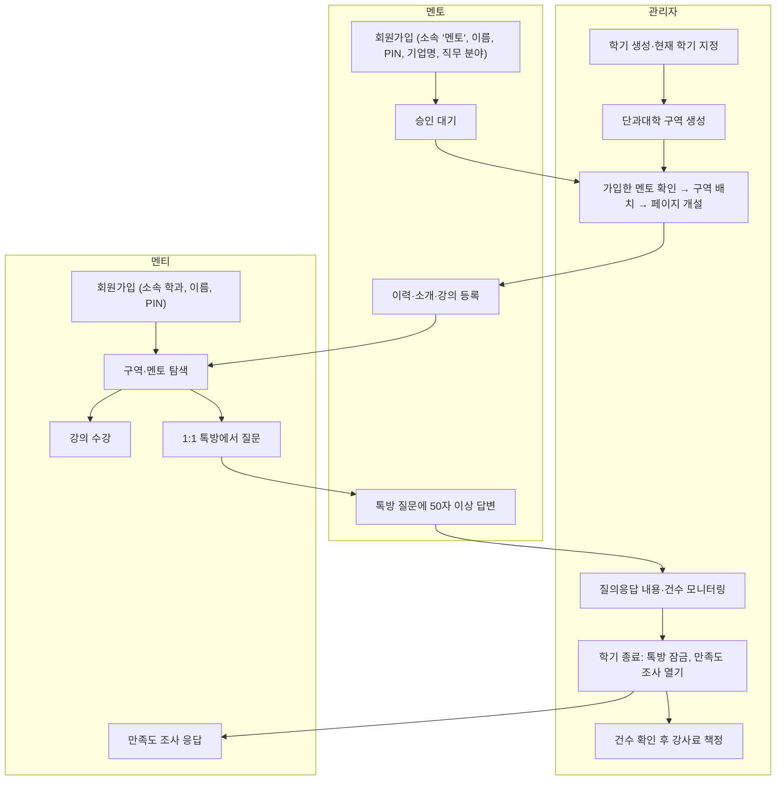
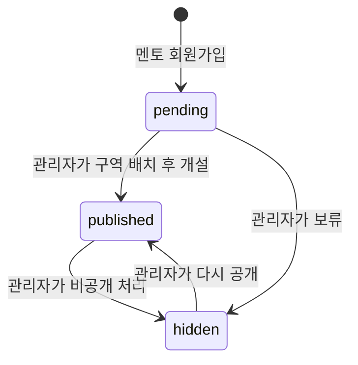
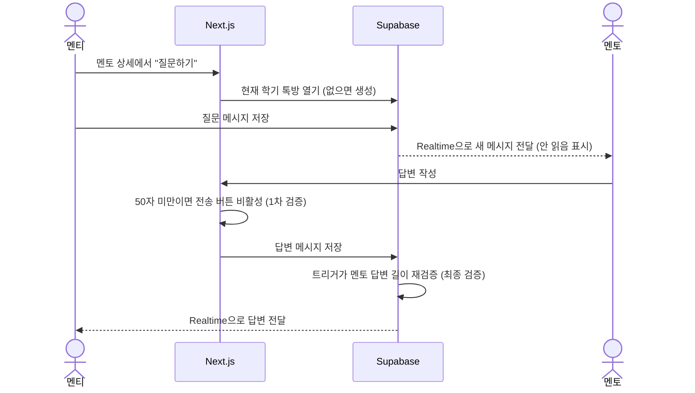
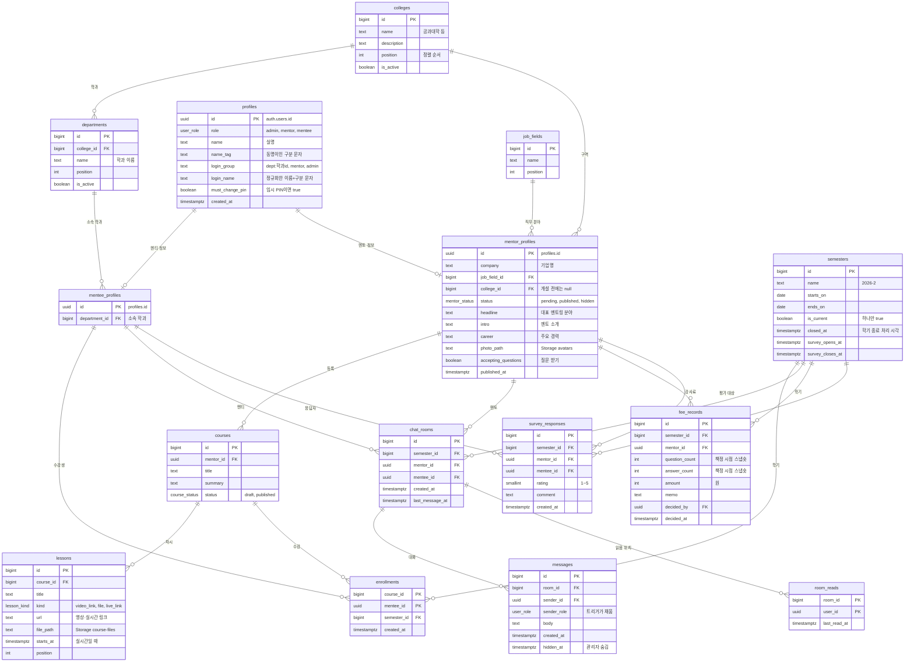

# 서비스 구조 설계

[README](../README.md)의 기획과 [잇다 구조 분석](itdaa-structure.md)을 합쳐 만든 hoseo.mentor-bridge의 구조 설계입니다. 구현할 때 이 문서를 기준으로 삼고, 바뀌는 내용은 이 문서에 먼저 반영합니다.

- 작성일: 2026-10-29
- 스택: Next.js 16 (App Router) + Supabase (Auth, Postgres, Realtime, Storage) + refine(관리자 화면)
- README "추가 확인 사항"과 설계 중 새로 생긴 결정 사항은 2026-10-29에 [11장](#11-결정-사항)의 값으로 확정했습니다. 나중에 바뀌어도 고칠 곳이 적도록 규칙을 설정 테이블과 함수에 모아 두었습니다.

## 목차

1. [설계 원칙](#1-설계-원칙)
2. [역할과 권한](#2-역할과-권한)
3. [핵심 흐름](#3-핵심-흐름)
4. [화면 구조](#4-화면-구조)
5. [데이터 모델](#5-데이터-모델)
6. [핵심 규칙 구현](#6-핵심-규칙-구현)
7. [보안 (RLS)](#7-보안-rls)
8. [실시간과 알림](#8-실시간과-알림)
9. [프런트엔드 구조](#9-프런트엔드-구조)
10. [운영 제약](#10-운영-제약)
11. [결정 사항](#11-결정-사항)
12. [구현 단계](#12-구현-단계)

## 1. 설계 원칙

| 원칙 | 내용 |
| --- | --- |
| 단과대학 중심 | 잇다는 직무 카테고리가 최상위지만, 우리는 **단과대학 구역**이 최상위이고 직무 분야는 보조 필터입니다. |
| 관리자가 문을 연다 | 멘토는 가입만으로 공개되지 않습니다. 관리자가 구역에 배치하고 멘토 페이지를 개설해야 공개됩니다. |
| 학기 단위 | 톡방, 수강, 강사료, 만족도 조사는 모두 학기에 묶입니다. 학기가 끝나면 톡방은 읽기 전용이 됩니다. |
| 보안은 DB에서 | 권한은 화면이 아니라 Supabase RLS 정책으로 지킵니다. 화면의 권한 검사는 사용 편의를 위한 것입니다. |
| 규칙은 한 곳에 | 50자 기준처럼 바뀔 수 있는 규칙은 설정 테이블과 함수 하나에 모아 둡니다. |
| 작게 시작 | 학교 안 소규모 운영이므로 무료 플랜 안에서 동작하게 만들고, 잇다의 광고·VOD·유료화 기능은 넣지 않습니다. |

## 2. 역할과 권한

### 2.1 역할

| 역할 | 누구 | 계정 생성 | 로그인 |
| --- | --- | --- | --- |
| 멘티 (`mentee`) | 재학생 | 직접 가입 (소속 학과, 이름, PIN) | 학과 + 이름 + PIN |
| 멘토 (`mentor`) | 기업 현직자 | 직접 가입 (소속 "멘토", 이름, PIN, 기업명, 직무 분야) → 관리자가 페이지 개설 | "멘토" + 이름 + PIN |
| 관리자 (`admin`) | 운영 담당 교직원·학생 | 다른 관리자가 만듦. 첫 관리자는 설치 스크립트로 생성 (가입 화면으로는 될 수 없음) | "관리자" + 이름 + PIN |

### 2.2 기능별 권한

| 기능 | 비로그인 | 멘티 | 멘토 | 관리자 |
| --- | :---: | :---: | :---: | :---: |
| 단과대학 구역·멘토 목록·멘토 상세 보기 | | ✅ | ✅ | ✅ |
| 강의 목록·소개 보기 | | ✅ | ✅ | ✅ |
| 강의 수강 신청, 자료 보기 | | ✅ | | ✅ (보기) |
| 멘토에게 1:1 질문 (톡방 열기) | | ✅ | | |
| 톡방에서 답변 (50자 이상) | | | ✅ 본인 톡방 | |
| 본인 페이지 이력·소개 편집, 강의 등록 | | | ✅ | ✅ |
| 단과대학 구역 관리 | | | | ✅ |
| 멘토 승인·구역 배치·페이지 개설 | | | | ✅ |
| 모든 톡방 내용과 건수 보기 | | | | ✅ |
| 강사료 책정 | | | | ✅ |
| 학기 관리, 만족도 조사 결과 보기 | | | | ✅ |
| 만족도 조사 응답 | | ✅ (학기 말) | | |
| 내 PIN 변경 | | ✅ | ✅ | ✅ |
| 다른 사용자 PIN 초기화, 이름·소속 변경, 관리자 계정 생성 | | | | ✅ |

비로그인 사용자는 로그인·회원가입 화면만 볼 수 있습니다. 멘토의 실명과 소속을 보호하기 위해서입니다 (11장 8번).

## 3. 핵심 흐름

### 3.1 한 학기 운영 흐름



### 3.2 멘토 페이지 상태



- `published`가 되려면 단과대학 구역(`college_id`)이 반드시 있어야 합니다.
- 멘토 본인은 상태와 구역을 바꿀 수 없습니다. 소개, 경력, 사진, "질문 받기" 여부만 바꿉니다.

### 3.3 1:1 질문과 답변



## 4. 화면 구조

### 4.1 사이트맵과 접근 권한

| 경로 | 화면 | 접근 | 잇다에서 가져온 요소 |
| --- | --- | --- | --- |
| `/` | 홈: 단과대학 구역 카드, 추천 멘토, 모집 중인 강의 | 로그인 | 메인 섹션 구성 |
| `/colleges/[collegeId]` | 단과대학 구역: 구역 소개, 소속 멘토 카드 | 로그인 | 멘토 카드 |
| `/mentors` | 멘토 찾기: 구역·직무 분야 필터, 검색, 페이지 | 로그인 | 필터 바, URL 배열 파라미터 |
| `/mentors/[mentorId]` | 멘토 상세: 프로필, 활동 지표, 소개, 경력, 강의, 질문하기 | 로그인 | 프로필 헤더, 지표, 소개·경력 |
| `/courses/[courseId]` | 강의 상세: 소개, 차시 목록, 수강 신청 | 로그인 | 클래스 상세 구성 |
| `/chats` | 내 톡방 목록 (안 읽은 수) | 멘티·멘토 | |
| `/chats/[roomId]` | 1:1 톡방 | 해당 멘티·멘토, 관리자(읽기) | |
| `/mypage` | 내 정보, 수강 중인 강의, 만족도 조사 | 멘티 | |
| `/mentor` | 멘토 대시보드: 받은 질문, 내 페이지 편집, 강의 관리 | 멘토 | |
| `/admin` | 관리자 (refine) | 관리자 | |
| `/admin/semesters` | 학기 생성·현재 학기·종료 | 관리자 | |
| `/admin/colleges` | 단과대학 구역과 소속 학과 관리 | 관리자 | |
| `/admin/mentors` | 승인 대기 멘토, 구역 배치, 개설·비공개 | 관리자 | |
| `/admin/users` | 사용자 목록, PIN 초기화, 이름·소속 변경, 관리자 계정 생성 | 관리자 | |
| `/admin/chats` | 전체 톡방 목록·내용, 멘토별 질문·답변 건수 | 관리자 | |
| `/admin/fees` | 학기별 강사료 책정 | 관리자 | |
| `/admin/surveys` | 만족도 조사 결과 | 관리자 | |
| `/auth/login`, `/auth/sign-up` | 로그인(소속·이름·PIN), 역할별 회원가입 | 비로그인 | |
| `/account/pin` | PIN 변경. 임시 PIN으로 로그인하면 이 화면으로 이동 | 로그인 | |

필터는 잇다처럼 URL에 담아 공유와 뒤로 가기를 지원합니다. 예: `/mentors?college=3&field=7&q=백엔드&page=2`

### 4.2 주요 화면 구성

**멘토 카드**: 사진 · 이름 · 기업명 · 직무 분야 · 대표 멘토링 분야 한 줄 · 단과대학 구역 · 상태(`질문 가능` / `질문 마감`)

**멘토 상세**

1. 프로필 헤더: 사진, 단과대학 구역, 이름, 기업명, 직무 분야
2. 활동 지표: 답변 수, 답변율(질문 받은 톡방 중 답변한 비율), 수강생 수
3. 버튼: **질문하기** (멘티만, 멘토가 질문 받기를 켠 경우)
4. 대표 멘토링 분야, 멘토 소개, 주요 경력
5. 등록한 강의 목록

**1:1 톡방**: 상대 정보 헤더 · 메시지 목록(질문·답변 말풍선) · 입력창. 멘토 입력창은 글자 수를 실시간으로 보여 주고 50자 전에는 전송을 막습니다. 학기가 끝난 톡방은 입력창 대신 "종료된 톡방" 안내를 보여 줍니다.

**로그인**: 소속 선택(단과대학별 학과 목록, "멘토", "관리자") · 이름 · PIN 6자리

**회원가입**: 소속에서 학과를 고르면 멘티로, "멘토"를 고르면 멘토로 가입합니다. 가입 화면의 소속 목록에는 "관리자"가 없습니다.

| 역할 | 공통 | 역할별 |
| --- | --- | --- |
| 멘티 | 소속(학과), 이름, PIN, PIN 확인 | 없음 |
| 멘토 | 소속("멘토"), 이름, PIN, PIN 확인 | 기업명, 직무 분야 (선택 목록) |

같은 소속에 같은 이름이 이미 있으면 구분 문자 입력칸을 보여 주고 이름 뒤에 붙이라고 안내합니다 ([6.1](#61-로그인과-가입-소속이름pin)).

## 5. 데이터 모델

### 5.1 ERD



`app_settings`(설정값 한 줄짜리 테이블)는 관계가 없어 그림에서 뺐습니다.

### 5.2 테이블 설명과 제약

| 테이블 | 역할 | 주요 제약 |
| --- | --- | --- |
| `profiles` | 모든 사용자의 공통 정보와 로그인 키. `auth.users`와 1:1 | 가입 트리거만 생성. `(login_group, login_name)` 중복 불가. `role`·이름·소속은 관리자만 변경 |
| `mentee_profiles` | 멘티의 소속 학과 | 멘티일 때만 존재. `department_id`는 `profiles.login_group`과 일치 |
| `mentor_profiles` | 멘토 페이지 내용과 공개 상태 | `status = 'published'`이면 `college_id` 필수. `status`, `college_id`, `published_at`은 관리자만 변경 |
| `colleges` | 단과대학 구역 | `name` 중복 불가 |
| `departments` | 단과대학 아래 학과. 가입·로그인의 소속 목록 | (단과대학, 이름) 중복 불가. 로그인 키가 학과 id를 쓰므로 지우지 않고 `is_active = false`로 숨김 |
| `job_fields` | 직무 분야 목록 (관리자 관리) | `name` 중복 불가 |
| `semesters` | 학기 | `is_current = true`는 하나만 (부분 유니크 인덱스) |
| `courses` | 멘토 강의 | 작성자는 멘토 본인 |
| `lessons` | 강의 차시. 영상 링크, 파일, 실시간 링크 중 하나 | `kind`에 맞는 열만 값 존재 (CHECK) |
| `enrollments` | 수강 신청 | (강의, 멘티) 중복 불가. `semester_id`는 신청 시점의 현재 학기 (트리거) |
| `chat_rooms` | 멘티-멘토 1:1 톡방 | (학기, 멘토, 멘티) 중복 불가 |
| `messages` | 톡방 메시지 | 멘토 메시지는 답변 길이 규칙 통과 필수. 수정·삭제 불가 (관리자 숨김만) |
| `room_reads` | 사용자별 마지막 읽은 시각 | 안 읽은 수 계산용 |
| `fee_records` | 학기별 멘토 강사료 | (학기, 멘토) 중복 불가 |
| `survey_responses` | 학기 말 멘토 만족도 | (학기, 멘토, 멘티) 중복 불가. 그 학기에 해당 멘토와 톡방이 있던 멘티만 |
| `app_settings` | 바뀔 수 있는 운영 규칙 | 한 줄만 존재 |
| `admin_invites` | 관리자 계정 생성 허가 (6.1) | secret 키로만 읽고 씀. 가입 트리거가 쓰고 지움 |

`app_settings` 열:

| 열 | 기본값 | 의미 |
| --- | --- | --- |
| `answer_min_length` | `50` | 멘토 답변 최소 글자 수 |
| `answer_count_spaces` | `false` | 글자 수에 공백을 포함할지. 공백 제외로 확정 |
| `public_browsing` | `false` | 비로그인 사용자도 멘토·강의를 볼 수 있는지. 로그인 사용자만으로 확정 |

### 5.3 DB 함수

| 함수 | 용도 |
| --- | --- |
| `normalize_login_name(raw)` | 이름 + 구분 문자를 `login_name`으로 정규화. 앱의 `normalizeLoginName()`과 같은 결과를 냄 (6.1) |
| `login_email(login_group, login_name)` | 가상 이메일 계산. 앱의 `lib/auth/login-key.ts`와 같은 결과를 냄 (6.1) |
| `is_admin()` | 현재 사용자가 관리자인지. RLS 정책에서 사용 (비로그인 실행 권한 없음) |
| `is_backend()` | secret 키(`service_role`)나 운영 SQL로 들어온 요청인지. 보호 열 트리거에서 사용 |
| `is_room_member(room_id)` | 현재 사용자가 톡방 참여자인지 |
| `answer_length(body)` | `app_settings` 기준 글자 수 계산 (공백 포함 여부 반영) |
| `handle_new_user()` | `auth.users` 생성 시 `profiles`와 역할별 테이블 생성 (트리거) |
| `guard_login_email()` | `auth.users`의 이메일이 바뀔 때 `profiles`의 로그인 키와 맞는지 확인 (트리거) |
| `protect_profile_columns()`, `protect_mentor_columns()` | 보호 열 변경 차단 (트리거, 6.1·6.2) |
| `open_chat_room(mentor_id)` | 멘티가 현재 학기 톡방을 열거나 기존 방 반환 (RPC) |
| `admin_semester_stats(semester_id)` | 멘토별 톡방 수, 질문 수, 답변 수, 마지막 답변 시각 (관리자 전용 RPC) |
| `close_semester(semester_id)` | 학기 종료: `closed_at` 기록, 만족도 조사 기간 설정 (관리자 전용 RPC) |

Supabase Edge Function `admin-users`는 PIN 초기화, 이름·소속 변경, 관리자 계정 생성을 맡습니다. Supabase 관리자 API가 필요한 작업이라 DB 함수가 아니라 Edge Function으로 두고, 호출한 사람이 관리자인지 먼저 확인합니다.

## 6. 핵심 규칙 구현

### 6.1 로그인과 가입 (소속·이름·PIN)

Supabase Auth는 이메일(또는 전화번호)과 비밀번호로 계정을 만듭니다. 그래서 사용자가 입력한 소속과 이름으로 **가상 이메일**을 계산하고, PIN을 비밀번호로 씁니다. 사용자는 이메일을 보거나 입력하지 않습니다.

**로그인 키**

| 값 | 만드는 방법 | 예 |
| --- | --- | --- |
| `login_group` | 멘티 `dept:<학과 id>`, 멘토 `mentor`, 관리자 `admin` | `dept:12` |
| `login_name` | 이름 + 구분 문자를 유니코드 정규화(NFC)하고, 공백을 모두 빼고, 영문은 소문자로 | `홍길동a` |
| 가상 이메일 | `u-` + SHA-256(`login_group` + `\|` + `login_name`)의 앞 32자 + `@login.hoseo-mentor.invalid` | `u-3f9c…@login.hoseo-mentor.invalid` |

- 같은 계산을 앱(`lib/auth/login-key.ts`)과 DB(`login_email()`)에 둡니다. 앱은 로그인·가입에, DB는 가입 검증에 씁니다.
- 학과 이름이 바뀌어도 학과 id는 그대로라 로그인에 영향이 없습니다.
- 가상 주소로 메일이 나가지 않도록 Supabase의 이메일 인증(Confirm email)을 끕니다.
- 도메인은 예약 최상위 도메인 `.invalid`(RFC 2606)를 씁니다. 실제로 있을 수 없는 주소라 혹시 메일이 나가도 남의 서버로 가지 않고, 배포 도메인(11장 11번)과도 상관이 없습니다. 바꾸면 모든 계정의 로그인 키가 바뀌므로 고정합니다.
- 2026-10-30에 실제 프로젝트에서 확인했습니다: 이 도메인으로 `signUp`이 받아들여지고 바로 세션이 나옴, 틀린 PIN은 `invalid_credentials`, PIN 변경은 현재 PIN이 없거나 틀리면 거부(`current_password_required`, `current_password_invalid`).

**가입**

1. 화면에서 소속, 이름, (필요하면) 구분 문자, PIN 6자리, PIN 확인을 받습니다. 멘토는 기업명과 직무 분야도 받습니다.
2. 서버 액션이 PIN 형식(숫자 6자리)을 검사하고, 가상 이메일을 계산해 `supabase.auth.signUp()`을 호출합니다. 소속·이름·역할별 정보는 `options.data`로 넘깁니다.
3. `handle_new_user()` 트리거가 다시 검사하고 `profiles`와 역할별 테이블을 만듭니다.
   - 이메일이 `login_email(login_group, login_name)`과 같은지 확인합니다. API를 직접 불러 임의의 이메일로 가입하는 것을 막습니다.
   - 소속이 `admin`이면 거부합니다. 단, secret 키로만 쓸 수 있는 `admin_invites`에 그 이메일의 허가(10분 유효)가 있으면 허가를 지우고 관리자로 만듭니다(첫 관리자 스크립트, `admin-users`). Supabase Auth는 사용자를 만든 뒤에 `app_metadata`를 저장해서 트리거가 볼 수 없기 때문에 허가 표를 씁니다. `mentor`이면 멘토로 만들고, `dept:<id>`이면 쓰고 있는 학과인지 확인한 뒤 멘티로 만듭니다.
   - 멘토는 `job_field_id`를 확인하고 `status = 'pending'`으로 만듭니다.
4. 이메일 인증이 없으므로 가입 직후 바로 로그인됩니다.

**동명이인**: `(login_group, login_name)`은 중복될 수 없습니다. 같은 소속에 같은 이름이 있으면 가입 화면이 구분 문자(영문·숫자 1~3자, 예: `A`)를 붙이라고 안내합니다. 화면에는 `홍길동A`처럼 이름과 구분 문자를 함께 보여 주고, 로그인할 때도 이름칸에 `홍길동A`라고 씁니다.

**이름에 쓸 수 있는 글자**: 한글 음절·영문과 그 사이의 공백 한 칸, 30자까지입니다 (`profiles.name` CHECK). 보이지 않는 글자(폭 없는 공백 등)를 섞어 남과 같아 보이는 이름으로 가입하는 것을 막기 위해서입니다.

**로그인 키 가로채기 방지**: 사용자가 `updateUser({ email })`로 이메일을 남의 가상 이메일로 바꾸면, 그 사람이 나중에 가입할 로그인 키를 미리 차지할 수 있습니다. `guard_login_email()` 트리거가 이메일은 늘 `login_email(profiles.login_group, profiles.login_name)`과 같아야 한다고 막습니다. 그래서 `admin-users`가 이름·소속을 바꿀 때는 `profiles`를 먼저 고친 뒤 이메일을 바꿉니다.

**로그인**: 소속·이름·PIN을 받은 서버 액션이 가상 이메일을 계산해 `signInWithPassword()`를 호출합니다. 실패하면 "소속, 이름 또는 PIN이 맞지 않습니다"라고만 안내해 어느 값이 틀렸는지 알려 주지 않습니다.

**PIN 변경 (누구나, 언제든)**

- `/account/pin`에서 현재 PIN, 새 PIN, 새 PIN 확인을 받습니다.
- Supabase의 "비밀번호를 바꿀 때 현재 비밀번호 요구(Require current password)"를 켜고 `updateUser({ current_password, password })`로 바꿉니다. 메일로 확인 코드를 보내는 "재인증(Secure password change)"은 메일이 없으므로 끕니다.
- 새 PIN이 숫자 6자리인지는 서버 액션에서 검사합니다. Supabase는 비밀번호 원문을 DB에 넘기지 않으므로 DB에서는 검사할 수 없습니다.
- 바꾸고 나면 `must_change_pin`을 `false`로 돌립니다.

**PIN 분실**: 메일이 없어 스스로 찾을 수 없습니다. 관리자가 `/admin/users`에서 임시 PIN을 정해 주면 `must_change_pin = true`가 되고, 그 사용자는 다음 로그인 때 `/account/pin`으로 이동합니다.

**이름·소속 변경**: 로그인 키가 바뀌므로 관리자만 합니다. 가상 이메일도 함께 바꿉니다.

**관리자 계정**: 가입 화면으로는 만들 수 없습니다. 관리자가 `/admin/users`에서 만들고(임시 PIN, 처음 로그인할 때 변경), 첫 관리자는 운영자 PC에서 한 번 실행하는 설치 스크립트로 만듭니다: `node --env-file=.env.local scripts/create-admin.mjs` (secret 키는 실행할 때 입력받고 저장하지 않음).

**임시 PIN**: PIN 초기화와 관리자 생성의 임시 PIN은 서버에서 무작위 6자리로 정해 관리자 화면에 한 번만 보여 줍니다.

PIN 초기화, 이름·소속 변경, 관리자 생성에는 Supabase 관리자 API가 필요합니다. 이 작업은 Edge Function `admin-users`가 secret 키로 처리하고, 호출한 사람이 관리자인지 먼저 확인합니다. Next.js 앱 코드에는 secret 키를 넣지 않습니다.

**무작위 대입 대책**

- PIN 6자리는 경우의 수가 100만 개입니다. Supabase는 로그인 요청을 IP마다 시간당 1,800회(순간 30회)로 제한합니다.
- 실패 횟수에 따라 계정을 잠그는 기능(Password Verification Hook)은 Supabase 유료(Teams 이상) 플랜에만 있어서 쓸 수 없습니다.
- 그래서 Supabase에 내장된 **CAPTCHA(Cloudflare Turnstile, 무료)**를 가입·로그인에 켭니다. 우리 화면을 거치지 않고 API를 직접 부르는 공격도 CAPTCHA 토큰이 있어야 하므로 함께 막힙니다. 실제 사용자를 받기 전에 반드시 켭니다.
- 이름과 학과는 남이 알 수 있는 정보라 PIN이 유일한 비밀입니다. 생일·학번처럼 추측하기 쉬운 숫자는 피하라고 화면에서 안내합니다.

### 6.2 멘토 페이지 개설

- 관리자 화면 `/admin/mentors`에 `pending` 멘토가 모입니다.
- 관리자가 단과대학 구역을 고르고 개설하면 `college_id`, `status = 'published'`, `published_at`이 한 번에 저장됩니다.
- 멘토 본인이 보호 열(`status`, `college_id`, `published_at`)을 바꾸려 하면 트리거가 막습니다. 관리자도 같은 `authenticated` 역할로 접속하므로 열 권한이 아니라 트리거에서 `is_admin()`으로 구분합니다.

### 6.3 50자 답변 검증

- **화면**: 멘토 입력창에 현재 글자 수와 기준을 보여 주고, 기준 미만이면 전송 버튼을 끕니다.
- **DB**: `messages` INSERT 트리거가 `sender_role`을 채우고, 멘토 메시지면 `answer_length(body) >= answer_min_length`를 검사합니다. 실패하면 에러를 돌려줍니다.
- 확정 기준은 **공백을 뺀 50자 이상**입니다. 기준이 바뀌면 `app_settings`만 고치면 됩니다. 화면은 같은 설정을 읽어 표시합니다.
- 한국어 한 글자는 Postgres `char_length`에서 1자로 셉니다.

### 6.4 톡방 규칙

- 톡방은 **학기마다** 멘티-멘토 쌍당 하나입니다. 다음 학기에 같은 멘토에게 질문하면 새 톡방이 열립니다.
- 열 수 있는 조건: 멘티 본인, 현재 학기 존재, 멘토가 `published`이고 `accepting_questions = true`
- 메시지를 쓸 수 있는 조건: 톡방 참여자이고 학기가 종료되지 않음
- 메시지는 수정·삭제할 수 없습니다. 강사료 산정 근거가 되기 때문입니다. 부적절한 메시지는 관리자가 숨깁니다(`hidden_at`).
- 수강 신청을 하지 않아도 질문할 수 있습니다. README에서 강의 수강과 질문은 별도 단계이기 때문입니다.

### 6.5 학기 운영

1. 관리자가 학기를 만들고 현재 학기로 지정합니다.
2. 학기 중에는 톡방·수강이 현재 학기에 기록됩니다.
3. 학기 종료(`close_semester`)
   - `closed_at`을 기록합니다. 이후 그 학기 톡방은 읽기 전용입니다.
   - 만족도 조사 기간(`survey_opens_at` ~ `survey_closes_at`)을 엽니다.
4. 만족도 조사: 그 학기에 톡방이 있던 멘티만, 해당 멘토마다 한 번 응답합니다 (README "종료 시 멘티 한정"의 해석, 11장 4번).
5. 다음 학기를 만들고 현재 학기로 바꿉니다.

### 6.6 질의응답 현황과 강사료

- `/admin/chats`: 학기·구역·멘토로 걸러 전체 톡방을 보고, 톡방을 열어 내용을 확인합니다.
- `admin_semester_stats()`가 멘토별 톡방 수, 질문 수(멘티 메시지), 답변 수(멘토 메시지), 마지막 답변 시각을 돌려줍니다.
- `/admin/fees`: 통계 옆에서 관리자가 금액을 입력하면 `fee_records`에 그 시점의 건수 스냅숏과 함께 저장합니다.
- 강사료 기준이 "답변 1건당 금액"처럼 정해지면 추천 금액을 자동 계산해 보여 주고, 최종 금액은 관리자가 확정합니다.

### 6.7 사용자 PC 기억 (로그인 유지)

- Supabase Auth 세션은 기본적으로 로그아웃할 때까지 유지되고, `@supabase/ssr`가 쿠키에 저장합니다. 지금 뼈대에서 이미 "재방문 시 사용자 기억"이 됩니다.
- 세션 최대 시간·미사용 만료 설정은 Supabase 유료(Pro) 플랜 기능이라 무료 플랜에서는 쓸 수 없습니다.
- 확정: 로그아웃할 때까지 로그인을 유지합니다. 1차에서는 "로그인 상태 유지" 체크박스를 두지 않습니다.
- 나중에 공용 PC 때문에 체크박스가 필요해지면, 체크를 끈 경우 브라우저를 닫으면 사라지는 쿠키로 저장하는 방식을 따로 구현합니다.

## 7. 보안 (RLS)

모든 테이블에 RLS를 켭니다. 보안 함수(`security definer`)는 `search_path`를 비워 두고 스키마 이름을 명시합니다.

| 테이블 | 조회 | 생성 | 수정 | 삭제 |
| --- | --- | --- | --- | --- |
| `profiles` | 본인, 관리자, 공개 멘토의 이름, 같은 톡방 상대 | 트리거 | 본인(`must_change_pin` 해제만), 관리자(`must_change_pin`만). 이름·소속·역할은 `admin-users`만 | `admin-users`가 auth 계정을 지우면 함께 지워짐 |
| `mentee_profiles` | 본인, 관리자, 톡방 상대 멘토 | 트리거 | `admin-users`만 (학과가 로그인 키라서) | `profiles`와 함께 |
| `mentor_profiles` | `published`는 로그인 사용자 전체, 본인, 관리자 | 트리거 | 본인(보호 열 제외), 관리자 | 관리자 |
| `colleges`, `departments`, `job_fields` | 모두 (비로그인 포함, 가입·로그인 화면의 선택 목록용) | 관리자 | 관리자 | 관리자 |
| `semesters`, `app_settings` | 로그인 사용자 | 관리자 | 관리자 | 관리자 |
| `courses`, `lessons` | `published`는 로그인 사용자 전체, 작성 멘토, 관리자 | 작성 멘토 | 작성 멘토, 관리자 | 작성 멘토, 관리자 |
| `enrollments` | 본인 멘티, 강의 멘토, 관리자 | 멘티 본인 | 없음 | 멘티 본인, 관리자 |
| `chat_rooms` | 참여자, 관리자 | `open_chat_room()`으로만 | 없음 | 없음 |
| `messages` | 참여자, 관리자 (숨김 메시지는 관리자만) | 참여자 (열린 학기) | 관리자(숨김) | 없음 |
| `room_reads` | 본인 | 본인 | 본인 | 없음 |
| `fee_records` | 관리자 | 관리자 | 관리자 | 관리자 |
| `admin_invites` | 없음 (secret 키만) | 없음 | 없음 | 없음 |
| `survey_responses` | 관리자 | 조건을 갖춘 멘티 | 없음 | 없음 |

**Storage 버킷**

| 버킷 | 공개 | 쓰기 | 읽기 |
| --- | --- | --- | --- |
| `avatars` | 공개 | 본인 폴더(`{user_id}/`)만 | 누구나 |
| `course-files` | 비공개 | 강의 작성 멘토 | 수강 멘티, 작성 멘토, 관리자 |

**키 관리**: 브라우저와 Next.js 서버에는 publishable key만 씁니다. 관리자 기능은 대부분 RLS로 처리하고, 관리자 API가 꼭 필요한 계정 작업(PIN 초기화, 이름·소속 변경, 관리자 생성)만 Edge Function `admin-users`에서 secret 키로 처리합니다. secret 키는 Supabase의 Edge Function 비밀 값과, 운영자 PC에서 설치 스크립트를 돌릴 때의 환경 변수에만 둡니다.

## 8. 실시간과 알림

- `messages`를 Supabase Realtime 게시 대상에 넣고, 톡방 화면에서 `room_id`로 걸러 구독합니다. Realtime은 RLS를 따르므로 참여자와 관리자만 메시지를 받습니다.
- 안 읽은 수 = 상대가 보낸 메시지 중 `room_reads.last_read_at` 이후 것. 톡방 목록과 상단 메뉴에 뱃지로 보여 줍니다.
- 이메일 알림(새 질문 도착 등)은 1차 범위에서 뺍니다. 필요하면 학교 메일 등 SMTP를 연결한 뒤 Edge Function으로 추가합니다.

## 9. 프런트엔드 구조

[bulletproof-react](../references/bulletproof-react/docs/project-structure.md)의 기능별 폴더 구조를 따릅니다. 이 프로젝트는 `src/` 없이 루트에 둡니다.

```text
app/                         라우트만 둠 (화면 조립)
├─ page.tsx                  홈
├─ colleges/[collegeId]/
├─ mentors/  mentors/[mentorId]/
├─ courses/[courseId]/
├─ chats/  chats/[roomId]/
├─ mypage/
├─ mentor/                   멘토 대시보드 (layout에서 역할 검사)
├─ admin/                    refine 관리자 (layout에서 역할 검사)
└─ auth/                     뼈대에 있던 인증 화면 (역할별 가입으로 수정)
features/                    기능별 코드
├─ auth/       components(LoginForm, SignUpForm, PinChangeForm), api
├─ colleges/   components, api
├─ mentors/    components(MentorCard, MentorFilter, MentorProfile), api
├─ courses/    components, api
├─ chats/      components(ChatRoom, MessageInput), api, hooks(useRoomMessages)
├─ surveys/    components, api
└─ admin/      refine 리소스 설정, 통계·강사료 화면
components/ui/               shadcn/ui 공통 컴포넌트
lib/supabase/                Supabase 클라이언트 (뼈대 그대로)
lib/auth/                    login-key(가상 이메일 계산), getCurrentUser, requireRole
types/database.types.ts      Supabase가 생성한 DB 타입
supabase/migrations/         DB 스키마 SQL
supabase/functions/admin-users/   관리자 계정 작업 Edge Function
scripts/create-admin.mjs     첫 관리자 생성 (운영자 PC에서 한 번 실행)
```

| 주제 | 방식 |
| --- | --- |
| 데이터 읽기 | 서버 컴포넌트에서 `lib/supabase/server.ts`로 조회 |
| 데이터 쓰기 | 서버 액션 또는 RPC 호출. 톡방 전송만 브라우저 클라이언트로 직접 INSERT (Realtime과 같은 경로) |
| 실시간 | `features/chats/hooks`에서 브라우저 클라이언트로 구독 |
| 접근 제어 | `proxy.ts`는 세션 갱신과 로그인 여부, `mentor/`·`admin/` 레이아웃은 역할 검사. 최종 판단은 RLS |
| 관리자 | refine + `@refinedev/supabase`. 목록·수정 화면은 refine이 만들고, 통계·강사료는 직접 만든 화면 |
| 타입 | 스키마가 바뀔 때마다 Supabase 타입을 다시 생성 |
| 뼈대 정리 | 튜토리얼 컴포넌트, Vercel 배포 버튼, `/protected` 예제 화면, 메일을 쓰는 인증 화면(비밀번호 찾기·재설정, 가입 확인 메일 안내)은 구현 1단계에서 지움 |

## 10. 운영 제약

Supabase 무료 플랜 기준입니다. 무료 한도는 **조직 전체 합산**이라, 같은 `TeaJoSan` 조직의 `teajosan` 프로젝트와 나눠 씁니다.

| 항목 | 무료 한도 | 이 서비스에 주는 영향 |
| --- | --- | --- |
| DB 크기 | 프로젝트당 500MB | 텍스트 위주라 충분. 넘으면 읽기 전용 |
| 파일 저장 | 1GB (조직 합산) | **강의 영상 직접 업로드는 어려움** → 영상은 외부 링크(예: 유튜브 일부 공개) 권장 |
| 전송량 | 5GB/월 (조직 합산) | 사진은 작게 줄여 올림 |
| Realtime 동시 접속 | 200 | 소규모 운영에 충분 |
| 일시 정지 | 7일간 사용이 적으면 자동 정지 | **방학 중 정지될 수 있음**. 경고 메일이 오면 대시보드 방문으로 막고, 정지되면 90일 안에 대시보드에서 복구 |
| 세션 만료 설정 | Pro 플랜 기능 | 6.7 참고 |
| 로그인 요청 제한 | IP마다 시간당 1,800회, 순간 30회 (바꿀 수 없음) | 학교 Wi-Fi는 여러 사람이 같은 IP를 씀. 오리엔테이션처럼 수십 명이 한꺼번에 로그인하면 잠깐 거부될 수 있고, 몇 초 뒤 다시 하면 됨 |
| 로그인 실패 잠금 | 유료(Teams 이상) 플랜 기능 | CAPTCHA로 대신함 (6.1) |
| 메일 | 기본 발송은 테스트용 | PIN 로그인이라 인증 메일을 쓰지 않음. 나중에 알림 메일을 넣을 때만 SMTP 필요 |

그 밖의 운영 준비

- **배포처 미정**: 학교 운영 주체와 이용 조건에 맞는 호스팅을 골라야 합니다 (예: Vercel 무료 플랜은 개인·비상업 용도 조건).
- **개인정보**: 이름, 학과, 소속 회사, 질문 내용을 다루므로 개인정보 처리방침과 수집 동의 화면이 필요합니다.
- **백업**: 무료 플랜은 자동 백업 다운로드가 없으므로 학기 말에 데이터를 내보내 보관합니다.

## 11. 결정 사항

2026-10-29에 권장값으로 확정했습니다. 같은 날 로그인 방식이 소속·이름·PIN으로 바뀌어 6·7번을 고치고 12~16번을 더했습니다. 바뀌면 "바꿀 곳"만 고치면 되도록 설계했습니다. 출처가 "설계 기본값"인 항목은 설계하면서 정한 값이라 언제든 바꿀 수 있습니다.

| # | 항목 | 출처 | 확정값 | 바꿀 곳 |
| --- | --- | --- | --- | --- |
| 1 | 50자에 공백 포함 여부 | README | 공백 제외 (빈칸으로 글자 수 채우기 방지) | `app_settings.answer_count_spaces` |
| 2 | 강의 제공 방식 | README | 영상 링크·자료 파일·실시간 링크 모두 지원. 영상은 외부 링크로 등록 | `lessons.kind` |
| 3 | 강사료 책정 기준 | README | 질의응답 건수는 자동 집계, 금액은 관리자가 입력 | `/admin/fees` |
| 4 | 학기 종료 시 "멘티 한정" 의미 | README | 만족도 조사는 그 학기 톡방이 있던 멘티만 응답 | `survey_responses` 정책 |
| 5 | 사용자 PC 기억 범위 | README | 로그아웃할 때까지 로그인 유지 (Supabase 기본값), 유지 끄기 체크박스 없음 | 로그인 화면, 쿠키 처리 |
| 6 | 로그인 수단 | README, 사용자 | 소속(학과 / "멘토" / "관리자") + 이름 + 개인 PIN. 이메일·소셜 로그인 없음 | 6.1, `lib/auth/login-key.ts` |
| 7 | 학교 메일 사용 | 사용자 | **보류**. 가입할 때 이메일을 받지 않음 | — |
| 8 | 비로그인 탐색 허용 | 새로 생김 | 허용 안 함. 로그인한 사용자만 멘토·강의를 봄 (멘토 실명·소속 보호) | `app_settings.public_browsing` |
| 9 | 멘토의 강사료·만족도 열람 | 새로 생김 | 관리자만 | RLS 정책 |
| 10 | 멘티 한 명이 질문할 수 있는 멘토 수 | 새로 생김 | 제한 없음 | `open_chat_room()` |
| 11 | 배포처·도메인 | 새로 생김 | **보류**. 6단계(배포)에서 결정 | 배포 단계 |
| 12 | 동명이인 | 사용자 | 같은 소속에 같은 이름이 있으면 이름 뒤에 구분 문자(영문·숫자 1~3자) | 가입 화면, `profiles.name_tag` |
| 13 | PIN 형식과 변경 | 사용자 | 숫자 6자리. 사용자가 현재 PIN을 확인받고 언제든 바꿈 | 서버 액션 검사, Supabase 비밀번호 설정 |
| 14 | PIN 분실 | 설계 기본값 | 관리자가 임시 PIN 설정 → 다음 로그인 때 사용자가 바꿈 | `/admin/users`, `admin-users` |
| 15 | 이름·소속 변경 | 설계 기본값 | 관리자만 (로그인 키가 바뀌기 때문) | `/admin/users`, `admin-users` |
| 16 | 무작위 대입 대책 | 설계 기본값 | 가입·로그인에 Cloudflare Turnstile CAPTCHA. 실사용 전 필수 | Supabase Auth 설정 |
| 17 | 가상 이메일 도메인 | 사용자 | `login.hoseo-mentor.invalid` (2026-10-30 확정, 가입·로그인·PIN 변경 시험 통과) | `lib/auth/login-key.ts`, DB `login_email()` |

## 12. 구현 단계

| 단계 | 범위 | 완료 기준 |
| --- | --- | --- |
| 1. 기반 | 뼈대 정리, 공통 레이아웃·상단 메뉴, `colleges`·`departments`·`job_fields`, `profiles`·역할별 테이블, 가입 트리거, 소속·이름·PIN 가입·로그인·PIN 변경, `admin-users`와 첫 관리자 스크립트, `app_settings`, RLS 기본 | 학과를 고른 멘티와 "멘토"를 고른 멘토가 각각 PIN으로 가입·로그인·PIN 변경을 할 수 있고, 관리자가 PIN을 초기화할 수 있음 |
| 2. 구역·멘토 페이지 | refine 관리자(구역·학과, 멘토 개설), 멘토 페이지 편집, 탐색(목록·필터·상세) | 관리자가 개설한 멘토만 목록에 나오고, 멘토가 소개·경력을 고칠 수 있음 |
| 3. 1:1 톡방 | `semesters`(최소), `chat_rooms`, `messages`, `room_reads`, 50자 검증, Realtime | 멘티 질문이 멘토 화면에 바로 뜨고, 50자 미만 답변은 화면과 DB 모두에서 거부됨 |
| 4. 강의 | `courses`, `lessons`, `enrollments`, Storage 버킷 | 멘토가 강의를 올리고 멘티가 수강 신청 후 자료를 볼 수 있음 |
| 5. 운영 | 관리자 질의응답 열람·통계, 강사료, 학기 종료, 만족도 조사 | 한 학기를 처음부터 끝까지 테스트 데이터로 돌려 볼 수 있음 |
| 6. 배포 | 호스팅, Turnstile CAPTCHA, 도메인, 개인정보 처리방침, 백업 절차 | 학교 사용자가 실제 주소로 가입하고 쓸 수 있음 |

각 단계의 DB 변경은 `supabase/migrations/`에 SQL로 남기고, 적용 후 Supabase 보안 점검(advisors)으로 RLS 누락을 확인합니다.
