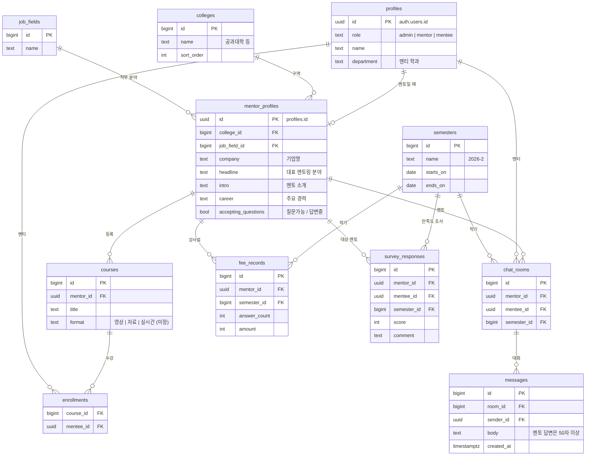

# 잇다(itdaa.net) 구조 분석

README의 참고 서비스인 [잇다](https://www.itdaa.net/)를 2026-10-29에 둘러보고, 우리 서비스에 옮길 **구조**(화면 구성, URL, 흐름, 데이터 모델)를 정리한 문서입니다.

- 로그인하지 않은 상태에서 공개 화면만 봤습니다. 로그인 후 화면(질문 작성, 마이페이지, 톡방)은 URL과 이동 흐름으로만 추정했습니다.
- 잇다의 문구, 이미지, 로고, 디자인 에셋, 멘토 개인정보는 가져오지 않습니다. 이 문서에도 실제 멘토 이름은 적지 않았습니다.
- 데이터 모델은 URL과 폼 필드 이름으로 추정한 것이며, 잇다의 실제 DB 구조와 다를 수 있습니다.

## 1. 기술 스택 (관찰)

| 항목 | 관찰 내용 | 근거 |
| --- | --- | --- |
| 서버 | Ruby on Rails, 서버에서 HTML 렌더링 | `authenticity_token` CSRF 메타 태그, rails-ujs, `/users/sign_in` 같은 REST 경로 |
| 인증 | Devise + OmniAuth (이메일, 네이버, 카카오, 구글) | `/users/sign_in`, `/users/auth/naver`, `/users/auth/kakao`, `/users/auth/google_oauth2` |
| 프런트엔드 | Webpacker 번들, jQuery, 일부 Tailwind CSS | `/packs/js/...`, `jquery-3.7.1`, `tailwind-*.chunk.css` |
| 에디터 | Froala (WYSIWYG, 상용 라이선스) | `froala_editor.pkgd.min.js` |
| 폰트 | Pretendard | jsDelivr의 `pretendard` CSS |
| 이미지·정적 파일 | CloudFront CDN, 이미지는 요청 시 리사이즈 | 이미지 URL이 base64로 인코딩된 `{bucket, key, edits.resize}` 형식 |
| 분석·광고 | Google Analytics, Meta 픽셀, AdSense | 외부 스크립트 |

우리 프로젝트는 Next.js + Supabase를 쓰므로 스택은 따라 하지 않고, 아래의 **화면·흐름·데이터 구조**만 참고합니다.

## 2. 사이트맵

```text
/                                   메인
├─ /mentors                          멘토 찾기 (= GNB "멘토에게 질문하기")
│   ├─ ?job_type[]=&mentoring_type[]=&page=   필터·페이지
│   ├─ /mentors/:id                  멘토 상세
│   └─ /mentors/:id/questions/new    멘토에게 1:1 질문 (로그인 필요)
├─ /auto_question/new                멘토 자동매칭 질문 (고민을 쓰면 카테고리·태그로 멘토 연결)
├─ /open_mentorings                  공개 Q&A 콘텐츠 목록 ("콘텐츠")
│   ├─ /open_mentorings/:id          Q&A 상세 (답변 일부는 가입해야 보임)
│   └─ /open_mentorings/:id/bookmarks  북마크
├─ /classes                          라이브 클래스 목록 ("현직자 클래스")
│   └─ /meetings/:id                 클래스 상세
│       ├─ /registrants/new          수강 신청 (사전 질문 포함)
│       ├─ /registrants              사전 질문 목록
│       ├─ /reviews                  수강 후기
│       └─ /waiting_seats/new        대기 신청 (마감 시)
├─ /vod                              녹화 강의 ("취준VOD")
├─ /personality_introductions/career|personality   진로·인성 검사
├─ /mentor_requests/new              멘토 지원 폼
├─ /relationships                    멘토 팔로우
├─ /partner_university               제휴대학 안내
├─ /clients/:id                      제휴 기관별 페이지
├─ /users/sign_in · /users/sign_up · /users/password/new   인증
├─ /cs/index                         1:1 고객센터
└─ /terms/term · /terms/privacy      약관
```

### GNB (상단 메뉴)

- 상단 줄: 검색창("직무, 회사, 멘토 검색"), 제휴대학 안내, 멘토지원, 파트너스, 로그인
- 메인 메뉴: 현직자 클래스 · 멘토에게 질문하기 · 멘토링 베스트 Pick · 취준VOD · AI 진단 검사(진로·인성·기업핏)
- 메뉴 항목은 `<a>` 링크가 아니라 스크립트 클릭으로 이동합니다. 우리는 접근성과 SEO를 위해 일반 링크로 만듭니다.

## 3. 화면별 구조

### 3.1 메인 (`/`)

위에서 아래 순서입니다.

1. 히어로 배너 캐러셀 (이벤트, 클래스 홍보)
2. 띠 배너 2개 (무제한 이용 안내, 멘토 모집)
3. **모집 중인 라이브 클래스** 카드 목록 + "모두보기"
4. **관심있는 멘토에게 질문하기**: 주제 탭(자소서/면접, 직무별 등) + 멘토 카드 10개
5. **나와 같은 고민일까?**: 최신 공개 Q&A 3개 (카테고리, 질문 제목, 질문 요약, 답변 멘토, 작성 시각)
6. 푸터 (고객센터 운영시간, 서비스 링크, 사업자 정보, 약관)

### 3.2 멘토 찾기 (`/mentors`)

- 상단 탭: 멘토에게 질문하기 / 질문 가이드(외부 Notion 문서)
- **멘토 자동매칭 배너**: "누구에게 물어야 할지 몰라도 괜찮다"는 안내와 "바로 질문하기" 버튼 → `/auto_question/new`
- **필터 바**
  - 직무 카테고리: 여러 개 선택 + 취소/적용하기 → `job_type[]=<id>` (21개)
  - 멘토링 주제: 여러 개 선택 → `mentoring_type[]=<id>` (12개)
  - 정렬: 최신순
- **멘토 카드 그리드** (한 페이지 약 60명, 페이지네이션 `?page=`, "끝" 버튼)

멘토 카드 구성 (클래스 이름 `mentor_list_*`):

| 요소 | 내용 |
| --- | --- |
| 사진 | 원형 프로필 이미지 (300px로 리사이즈) |
| 이름 | "OOO 멘토" |
| 소속 | 회사명 + 부서·직무 |
| 전문 분야 | 한 줄 소개 (말줄임) |
| 상태 스티커 | `질문가능` / `답변중` |

직무 카테고리 21개: 전체, 인사/총무/노무, 마케팅/MD, 홍보/CSR, 영업/영업관리, 해외영업, 회계/재무/금융, 전략/기획, 유통/무역/구매, 공사/공기업, IT개발/데이터, 서비스 기획/UI·UX, 디자인/예술, 미디어, 서비스, 연구/설계, 전문/특수, 교육/상담/컨설팅, 공무원/비영리, 생산/품질/제조, 기타 사무

멘토링 주제 12개: 전체, 해외취업, 직무, 진로, 스펙, 외국어, 자소서, 면접, 회사생활, 창업, 이직, 기타

### 3.3 멘토 상세 (`/mentors/:id`)

1. **프로필 헤더**: 사진, 직무 카테고리, 이름, 소속, 직무
2. **활동 지표 4개**: 답변율(%), 답변 수, 뱃지 수, 팔로워 수
3. **버튼 2개**: 팔로우(`/relationships`) · **멘토에게 질문하기**(`/mentors/:id/questions/new`, 로그인 필요)
4. **대표 멘토링 분야**: 한 줄 제목 + 해시태그(#직무 #진로 등 = 멘토링 주제)
5. **멘토 소개**: 자유 서술
6. **주요 경력**: 자유 서술 (학력, 경력, 프로젝트)
7. **고맙습니다**: 답변을 받은 멘티가 남긴 감사 글 목록 (작성자, 시각, 내용)

### 3.4 공개 Q&A (`/open_mentorings`, `/open_mentorings/:id`)

- 목록 필터: 직무 카테고리, 대상, 최신순
- 목록 카드: 카테고리, 질문 제목, 답변 미리보기, 답변 멘토(이름, 소속·부서), 작성 시각, 북마크 수
- 상세
  - 태그(#카테고리, #주제)를 누르면 필터된 목록으로 이동
  - 질문 본문 → 멘토 답변
  - **답변 잠금**: 앞부분만 보이고, 가입·제휴대학 인증·멘토 지원 중 하나를 해야 전체가 보임
  - 옆 칸: 답변 멘토 카드 (팔로우, 질문하기, 더보기)
  - 아래: 같은 카테고리의 인기 글

### 3.5 라이브 클래스 (`/classes`, `/meetings/:id`)

- 목록: 직무 카테고리 탭(`job_type[]`), 클래스 카드(회사, 멘토, 제목, 평점·후기 수, 일시, 마감까지 남은 시간, NEW 뱃지), 참여 가이드·멘토 가이드
- 상세 구성
  1. 유형(라이브 클래스, 실시간 질문답변), 남은 티켓 수, 가격
  2. 멘토 요약 (답변 수, 팔로워)
  3. 배우는 내용 → 커리큘럼(구간별 시간, 예: 소개 20분 / 특강 30분 / Live Q&A 90분)
  4. 추천 대상
  5. **수강 후기** (평점, `/reviews`)
  6. **사전 질문** (신청할 때 적는 질문, `/registrants`)
  7. 모집 중인 다른 클래스, 자주 하는 질문, 유의 사항
  8. 하단 고정 "클래스 신청하기" 버튼 → `/meetings/:id/registrants/new`

### 3.6 인증 (`/users/sign_in`, `/users/sign_up`)

- 로그인: 이메일 + 비밀번호, 네이버·카카오·구글 소셜 로그인, 비밀번호 찾기
- 회원가입 폼 필드: `user[name]`, `user[email]`, `user[password]` 세 개뿐입니다. 역할별 추가 정보는 가입 후에 받습니다.
- 로그인이 필요한 화면(질문 작성 등)에 들어가면 로그인 화면으로 보냅니다.

### 3.7 멘토 지원 (`/mentor_requests/new`)

- 안내: 서비스 소개, 멘토 활동(온라인 질문 답변, 온·오프라인 클래스, 명예멘토), 활동비 안내
- 폼 필드

| 필드 | 의미 |
| --- | --- |
| `mentor_request[organization]` | 회사명 |
| `mentor_request[department]` | 부서 |
| `mentor_request[position]` | 직급 |
| `mentor_request[job_type_id]` | 직무 카테고리 (선택) |
| `mentor_request[funnel]` | 알게 된 경로 (선택) |

지원서(`mentor_requests`)를 운영자가 확인한 뒤 멘토로 전환하는 구조로 보입니다.

### 3.8 제휴대학 (`/partner_university`)

- 학교별 제휴 혜택 안내 (학교마다 다름)
- 이용 방법: 재학생·휴학생·졸업생 대상, **학교 메일로 인증**하는 경우와 학교 메일이 없는 경우를 나눠 안내
- 제휴 학생은 잠긴 답변 보기 등 혜택을 받음

## 4. 추정 데이터 모델

URL 리소스 이름과 폼 필드에서 추정한 잇다의 모델입니다.

| 모델 | 근거 | 주요 필드(추정) |
| --- | --- | --- |
| User | `/users/*` | name, email, password, 소셜 계정 |
| MentorRequest | `/mentor_requests` | organization, department, position, job_type_id, funnel, 승인 상태 |
| Mentor (User + 프로필) | `/mentors/:id` | 소속, 부서, 한 줄 전문 분야, 소개, 경력, 답변율, 답변 수, 질문 가능 여부 |
| JobType | `job_type[]` | 21개 직무 카테고리 |
| MentoringType | `mentoring_type[]` | 12개 멘토링 주제 |
| Question | `/mentors/:id/questions` | 멘티, 멘토, 본문, 답변, 상태 |
| AutoQuestion | `/auto_question` | 고민 본문 → 카테고리·태그로 멘토 매칭 |
| Thank-you | 멘토 상세 "고맙습니다" | 멘티, 멘토, 내용 |
| Relationship | `/relationships` | follower, followed (팔로우) |
| OpenMentoring | `/open_mentorings` | 공개 질문·답변, 카테고리, 주제, 북마크 수 |
| Bookmark | `/open_mentorings/:id/bookmarks` | user, open_mentoring |
| Meeting | `/meetings/:id` | 클래스 제목, 멘토, 일시, 정원(티켓), 가격, 커리큘럼 |
| Registrant | `/meetings/:id/registrants` | 신청자, 사전 질문 |
| Review | `/meetings/:id/reviews` | 평점, 후기 |
| WaitingSeat | `/meetings/:id/waiting_seats` | 대기 신청자 |
| Client | `/clients/:id` | 제휴 기관(대학) |

## 5. 우리 서비스로 옮길 때 (README 요구사항 기준)

### 5.1 가져올 것과 바꿀 것

| 잇다 구조 | 우리 서비스 | 비고 |
| --- | --- | --- |
| 직무 카테고리가 최상위 분류 | **단과대학 구역**이 최상위, 직무 분야는 보조 필터 | README: 관리자가 단과대학별 구역 생성 |
| 누구나 멘토 지원 → 운영자 승인 | **관리자가 멘토 페이지 개설·등록** | 지원 폼 대신 관리자 등록 화면 |
| 멘토 카드 (사진, 이름, 소속, 전문 분야, 상태) | 그대로 사용 + 단과대학 표시 | |
| 멘토 상세 (지표, 소개, 경력, 감사 글) | 그대로 사용 + **등록 강의 목록** 추가 | README: 각 멘토 페이지에 이력과 강의 |
| 1:1 질문 (`/mentors/:id/questions/new`) | **1:1 톡방** (대화 이력 유지) | Supabase Realtime |
| 답변 길이 제한 없음 (관찰 불가) | **멘토 답변 50자 이상** | DB 제약 + 화면 검증 |
| 답변율, 답변 수 지표 | 그대로 사용 + **관리자 집계 화면**(건수, 내용, 강사료) | README: 강사료 책정 |
| 고맙습니다(감사 글) | **학기 말 멘토 만족도 조사**로 확장 | README 학기 운영 |
| 라이브 클래스 (일시, 정원, 사전 질문, 후기) | **멘토 강의** (형태 미정: 영상·자료·실시간) | README "강의 제공 방식" 확인 필요 |
| 가입: 이름·이메일·비밀번호 후 추가 정보 | 가입 시 역할별 정보: 멘토(소속 "멘토", 이름, PIN, 기업명, 직무 분야), 멘티(소속 학과, 이름, PIN) | |
| 이메일 + 소셜 로그인 | **소속 + 이름 + 6자리 PIN** 로그인. 학교 메일 인증은 보류 | [architecture.md 6.1](architecture.md#61-로그인과-가입-소속이름pin) |
| 필터를 URL 배열 파라미터로 (`job_type[]=`) | 같은 방식 (`?college=&field=&topic=`) | 공유·뒤로가기에 유리 |

### 5.2 빼는 것

광고·이벤트 배너, 취준VOD, AI 진단 검사, 공개 Q&A 콘텐츠와 답변 잠금(유료화 장치), 뉴스레터, 팔로우, 북마크, 대기 신청. 학교 안에서 소규모로 운영하므로 1차 범위에서 제외합니다. 필요해지면 다시 검토합니다.

### 5.3 우리 라우트 초안 (Next.js App Router)

```text
/                              메인: 단과대학 구역 목록, 추천 멘토
/colleges/[collegeId]          단과대학 구역: 소속 멘토 목록
/mentors                       멘토 찾기: ?college=&field=&topic=&page=
/mentors/[mentorId]            멘토 상세: 소개, 이력, 강의, 질문하기
/courses/[courseId]            강의 상세, 수강 신청
/chats                         내 1:1 톡방 목록
/chats/[roomId]                1:1 톡방 (멘티 질문 ↔ 멘토 답변 50자 이상)
/mypage                        내 정보, 수강 중인 강의
/mentor                        멘토 전용: 내 페이지 편집, 강의 등록, 받은 질문
/admin                         관리자 (refine)
  /admin/colleges              단과대학 구역 관리
  /admin/mentors               멘토 페이지 개설·등록
  /admin/qna                   전체 질의응답 내용·건수
  /admin/fees                  강사료 책정
  /admin/semesters             학기·만족도 조사
/auth/login · /auth/sign-up    인증 (역할별 가입 정보)
```

### 5.4 테이블 초안 (Supabase, 스키마 설계 단계의 출발점)

> 확정 설계는 [architecture.md](architecture.md)에 있습니다. 아래는 분석 당시의 초안입니다.



README "추가 확인 사항"(강의 형태, 강사료 기준, 50자 공백 포함 여부, 로그인 유지 범위, 학기 종료 절차)이 정해지면 이 초안을 다듬어 `supabase/migrations/`의 SQL로 옮깁니다.
